# Market-as-brain: first pass on real data

*Exploratory, 21–25 Nov 2026. All numbers come from the scripts in `src/`. Raw outputs are in `results/*.json`.*

**The final synthesis, with the literature check, is in [WRITEUP.md](WRITEUP.md).** This file is the full lab notebook.

## The short version

1. **Direction can't be predicted from past prices; magnitude can.** Out-of-sample R² is about 0 for tomorrow's direction and about 0.25 for tomorrow's size, and a flexible nonlinear learner doesn't change that. Nearly all of the market's "memory" is one slow state variable, volatility. Its feedback gain sits just below 1 (0.991 for the market, 0.995 median for industries, 0.992 median for stocks).
2. **Synchrony is an after-effect, not a warning.** Before the 25 worst months in 100 years, cross-industry synchrony was average (52nd percentile). It jumped to the 74th–78th percentile after and stayed there. Volatility, by contrast, was already elevated before (79th percentile).
3. **Neuronal-style avalanches exist, but they don't show the market is critical.** A null model of independent stocks driven by the market's actual volatility paths reproduces the avalanche size and duration distributions (KS ≈ 0.04), the branching ratio (0.946 vs 0.940) and the size of the COVID crash avalanche. The exponents also drift with the threshold, which a true critical point shouldn't do.
4. **The feedback sign flipped.** Before about 2000 the index trended at monthly horizons (variance ratio VR(21) ≈ 1.27, above 1). Since then it has mean-reverted (VR(21) = 0.75 ± 0.04, VR(63) = 0.64 ± 0.07), in the liquid S&P 500 too. In turbulent markets, the next day after a 2σ drop went from −59bp (1970–99) to +41bp (2000–26).
5. **The volatility state has two timescales, and the leftovers are not about timescale (Test 6).**
   - The market's volatility state is two units: a fast one (half-life about 2 weeks) and a slow one (about 1 year, day-to-day persistence 0.997, closer to unstable than the one-unit model implied). A third unit adds little.
   - Since 2000, the day after a big surprise is calmer than any of these models expect. That holds whether volatility responds to the size of a move or to its square. (Explained in Test 9 by a one-day refractory period.)
   - Across stocks there is real cross-sectional information. Yesterday's surprises in other stocks predict today's volatility beyond each stock's own state and beyond the index (+8% per SD, t = 15). That information is spread across many dimensions of co-movement: no single shared unit reproduces it, sectors account for a third of it, and 30 statistical factors still don't account for all of it.

6. **Volatility doesn't spread stock to stock; return information does (Test 7).** Common factors produce *symmetric* lagged links; contagion produces *one-way* ones.
   - **Volatility surprises.** 85% of the stable lagged links between stocks are symmetric. The one-way part runs between sectors: Communication Services, Real Estate, Materials and Energy lead, while Information Technology and Consumer Discretionary follow, in both 1990–2008 and 2008–2026. There is no stable stock-to-stock leadership within sectors, and the one-way part disappears once common factors are removed.
   - **Return direction.** 43% of the stable lagged structure is one-way. Stock-level leadership repeats across the two halves, also within sectors, and survives removing 10 common factors.

7. **The earnings calendar isn't the hidden structure (Test 8).**
   - Earnings news reaches peers the *same day*: same-sector peers who haven't reported yet get +15% volatility after a big surprise. Next-day spillover is under 2% and not significant.
   - Removing every earnings day leaves both the sector volatility leadership and the leftover firing persistence intact.
   - The calendar does explain part of the return lead-lag: companies that report early in the season lead in returns.

8. **Since about 1985, and strongly since the late 1990s, the market has a one-day refractory period (Test 9).**
   - After a big surprise, the next day's volatility is about half what the volatility state implies; then the elevated state resumes. (With a volatility model that doesn't overreact to big days it is about 60%, ranging 50–70% by market and period; Test 15.)
   - Scheduled news (Fed, CPI, jobs reports) adds one-day variance bumps but isn't the cause.
   - Adding the refractory term removes the post-2000 leftover structure: the day-to-day correlation of surprise size goes from −0.09 to 0.00, and BDS from −6.6 to −0.7.
   - Across a century of 6-year windows, the refractory period's strength tracks the market's turn to self-correction (r = 0.82). It was also present in the 1930s.

9. **The refractory period belongs to the market as a whole, not to individual stocks (Test 10).**
   - Individual stocks show none. After their own big surprises, the next day is not damped; the estimates sit at the level of a simulated no-effect null. In the 1990s, stocks showed the opposite: aftershocks.
   - Sector portfolios show it only in proportion to how much of their movement is the market. Since 2013, only the index itself shows it.
   - After a big market day, the index goes quiet but stocks' own (market-removed) moves get *louder*: +25% to +33% versus the model. The market desynchronizes for a day.
   - This points to index-level trading (index futures, ETFs, index-option hedging), not to ordinary stock-by-stock market making.

10. **Dealer option hedging isn't what creates the refractory period (Test 11).**
    - The dip after a big day is not deeper when dealers are long gamma; if anything it runs the other way, and the gamma effect vanishes once VIX is controlled.
    - Gamma's link to calm markets also shows up in stocks' stock-specific moves, which index hedging can't reach. So gamma is more likely a calm-regime marker than a damping force.
    - The dip is deepest when VIX is high. That points toward forced index-level flows under stress. The evidence for this is moderate and absent after 2020.

11. **One model built from these pieces reproduces the index, but not how stocks burst together (Test 12).**
    - The model: a market unit (two-speed volatility state, refractory period, reversal), 11 sector units and 237 stock units (own state, market spillover, earnings jumps).
    - Removing any one piece breaks the pattern that depends on it, so each piece is needed.
    - It misses the collective behaviour of stocks: how bursts of stock-specific activity persist from day to day (0.21 vs 0.54 real), avalanche sizes, and how tightly synchrony tracks volatility.
    - Adding a shared volatility "gain" across stocks helps some of these but not persistence.
    - Out of sample, the two-speed state and earnings jumps carry over. The refractory and reversal pieces are real in every era, but their strength drifts, so they don't improve forecasts.

12. **Collective bursts persist because stocks share a volatility state; no stock-to-stock excitation is needed (Test 13).**
    - Test 12's persistence gap had two sources: version 1 lacked the shared volatility gain, and the raw measure is dominated by a few crisis weeks.
    - On robust measures, the model with the shared gain matches real day-to-day burst persistence. That includes new stocks joining a burst, with no links between stocks in the model.
    - Adding two-day earnings reactions (version 3) fixes the stock-level aftershock.
    - The one collective event the model barely reaches is March 2020, when half of all stocks fired every day for a month. Only 1 of 60 simulated histories matched it.

13. **The market unit replicates in 15 markets worldwide, and its inhibition rose and fell everywhere in step (Test 14).**
    - The two-speed volatility state is significant in every market.
    - The refractory period appears in 14 of 15 markets in 2000–2012. Before 2000 it is mostly absent, and after 2012 it fades in most markets (with a robust model, all but Hong Kong and Taiwan; Test 15).
    - Those era differences survive controlling for stress, so they are structural rather than a by-product of the crisis years.
    - The trend-to-self-correction flip around 2000 is global among developed markets.

14. **The refractory period survives the obvious critique, smaller and in a narrower window (Test 15).**
    - The worry: squared-return volatility models overreact to big days, which alone makes the next day look calm.
    - With robust volatility models (EGARCH, score-driven Beta-t-EGARCH), which fit better, the dip remains significant in 12 of 15 markets in 2000–2012: about 61% of the state's forecast instead of 55%. Simulations with no refractory term give nothing like it.
    - With no model at all: after a big index day in 2000–2012, the next day's move is smaller than the following day's 55.9% of the time across 14 markets, against 50% in no-effect simulations and in other eras. Individual stocks show the opposite (48%).
    - After 2012 it is gone except in Hong Kong and Taiwan; the US post-2012 effect was the model overreacting.
    - Inside the next day, the index swings almost as much as usual but its close-to-close move is about half the following day's: it travels, but doesn't get far.

**Revised hypothesis (after Tests 6–15).**
- The market has a **low-dimensional global state**: two leaky volatility integrators, one fast and one slow. In brain terms that is something like arousal.
- Stocks are coordinated far more than the index shows, mostly through **shared inputs** (many weak common factors) rather than stock-to-stock "synapses". **Panic arrives through shared channels; it doesn't cascade like a seizure.**
- The genuinely directed, network-like part is **information flow**: some stocks' and sectors' return news reaches others a day later, partly because of the order companies report earnings in. Volatility news also flows between sectors in a stable order (Energy, Materials, Communication Services and Real Estate lead; Tech and Consumer Discretionary follow). That ordering is not explained by earnings timing.
- The **index-level loop changed from excitatory to inhibitory**, in two linked ways that move together across the century:
  - direction: today tends to reverse yesterday;
  - magnitude: after a big day comes a refractory day, whose net move is damped although intraday activity is close to normal (Test 15).

  In neural terms, the modern market behaves like an inhibition-dominated circuit: after each burst, its output is suppressed for a day while activity continues and cancels out.
- The refractory period is a property of the **collective mode only**. After a burst, the synchronized market mode is suppressed while individual units keep firing, and fire more. That is post-burst *desynchronization*, not a whole-network shutdown. The inhibition is applied to the index as a traded object, not neuron by neuron.
- It is **not dealer option hedging** (Test 11). The dip is deepest under stress (high VIX). The leading reading is a forced-flow overshoot at the index level that the volatility state mistakes for news.
- **One model built from these parts reproduces the index** (Test 12), so the index-level story above is close to complete.
  - Collective bursts across stocks are reproduced too, once stocks share a volatility gain (Test 13). Bursts persist and spread through a **shared modulatory state** (arousal plus a common gain), not through recurrent excitation between units. That matches Test 7's finding of no stock-to-stock volatility contagion.
  - The remaining open edge is extreme crises. March 2020's month-long mass firing sits at the very edge of what the model produces, and one event can't tell a separate "seizure" regime from a rare tail.
  - The inhibitory parts are present in every era, but their strength drifts. That looks more like changing wiring than a fixed law.
- **It's not a US quirk** (Test 14).
  - The two-speed memory is universal: the "hard-wired" part.
  - The inhibitory wiring switched on worldwide around 2000, peaked in 2000–2012 and faded after 2012 in most markets (with a robust model, everywhere except Hong Kong and Taiwan). That synchronized timing points to a global change in how markets trade, not to any one country's rules.
- **It survives a robust volatility model and a model-free test** (Test 15), at a smaller size: about 60% of the state's forecast in 2000–2012, not 50%.

## Data

| Source | What | Span |
|---|---|---|
| Ken French library (CRSP) | Market return, 49 value-weighted industry portfolios, daily | Jul 1926 – Sep 2026 |
| CBOE | VIX close | Jan 1990 – Nov 2026 |
| Yahoo Finance | Adjusted closes, 500 current S&P 500 members and the index | Jan 1990 – Nov 2026 |
| Yahoo Finance | Daily closes for 15 stock indices (Test 14); open/high/low/close for those indices, SPY and the 237 panel stocks (Test 15) | 1960 – Nov 2026 (varies by index) |

Also: SqueezeMetrics dealer-gamma estimates (Test 11), SEC EDGAR earnings filings (Test 8), and Fed and BLS release calendars (Test 9). Sources, spans and terms for every dataset are in [DATA.md](DATA.md).

The stock panel uses **current** S&P 500 members, so it has survivorship bias. Test 3 uses the 237 that have near-complete history since 1990.

## Test 1: where predictability lives

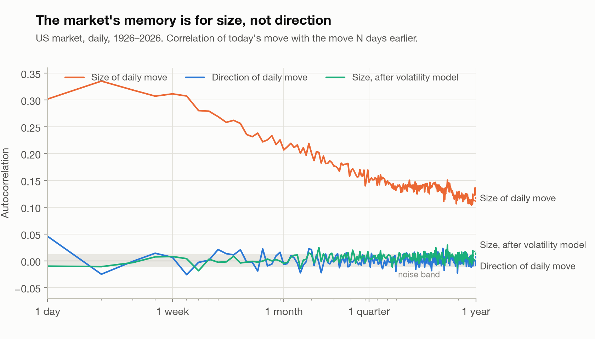

| | Direction | Magnitude |
|---|---|---|
| Lag-1 autocorrelation | 0.046 | 0.302 (still 0.117 at one year) |
| Walk-forward OOS R², linear on lags, 1936–2026 | −0.00002 | 0.248 |
| Gradient boosting, 40 lag features, last 40% OOS | −0.006 | 0.269 |
| Same learner, after removing the volatility state | −0.023 | 0.010 |

Sign accuracy is 53.6%, below the "always up" baseline of 54.9%.

- **Volatility model.** GJR-GARCH-t gives persistence 0.991 and a half-life of 74 days. Its residuals pass Ljung-Box on \|z\| (p = 0.33). Lagged information measured as mutual information falls from 0.48 bits to 0.022 bits (−95%).
- **But the model is not complete.** BDS on the residuals is −5.5 against a simulate-and-refit bootstrap null (p = 0.005). The negative sign means the residuals are *more* evenly spread than i.i.d., which points to wrong volatility dynamics (probably several timescales or long memory). GARCH's single exponential decay doesn't match the year-long memory in the chart.
- The tail index is ≈ 2.9, the known "cubic law".

## Test 2: synchrony as a market state

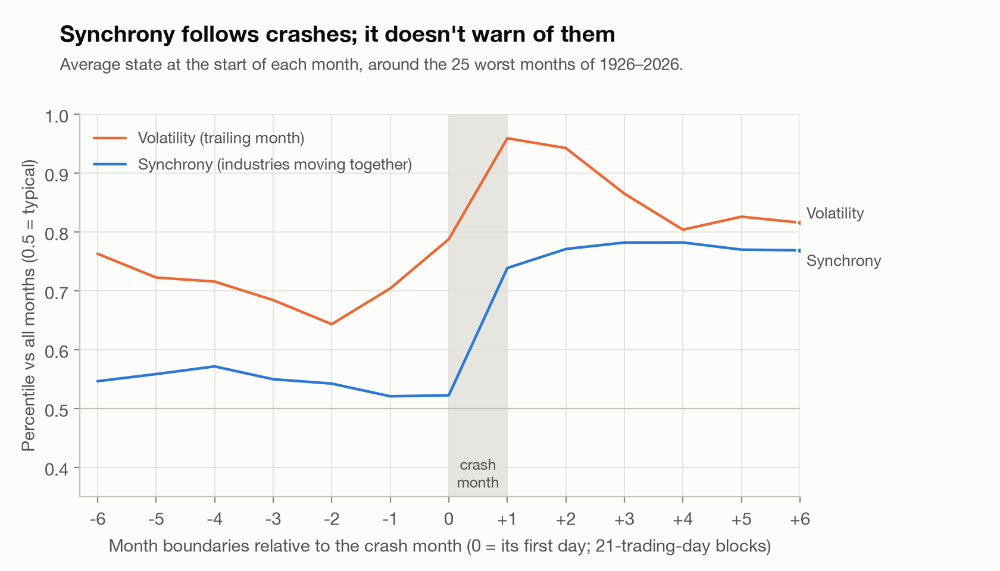

Synchrony is the mean pairwise correlation of the 49 industries over a rolling 6-month window.

- **Volatility forecasting.** Added to a multi-horizon volatility model, synchrony adds +0.003 OOS R² (Clark-West t = 3.9), but:
  - the coefficient is **negative**, so high synchrony at a given volatility means *lower* future volatility;
  - it fails in 1970–99;
  - it adds +0.0004 once VIX is included (VIX alone adds +0.056);
  - it adds nothing on individual stocks.
- **Next-month returns.** High synchrony forecasts *higher* returns in sample (t ≈ 2.2). Out of sample it doesn't hold within any single era.
- **One lead worth checking.** In high-volatility months, the next month crashed (worst 5% of months) 13.7% of the time when synchrony was low, against 5.0% when it was high (19/139 vs 7/139, Fisher p = 0.02). That cell was picked after the fact, so this is only a lead. The story would be that "high volatility, still dispersed" is more dangerous than "already synchronized" (capitulation).

## Test 3: avalanches against null models

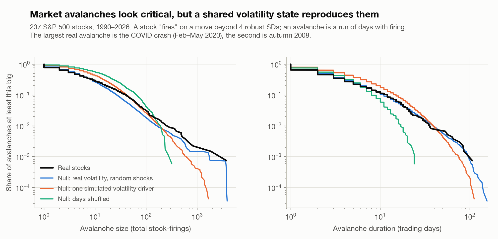

**Setup.** A stock "fires" when it moves more than K robust SDs of its own trailing year. An avalanche is a run of days with at least one firing, bounded by silent days (the Beggs & Plenz definition).

| Statistic (K = 4) | Real | Shuffled days | Factor, no vol memory | Factor + simulated GARCH | **Real-volatility null** |
|---|---|---|---|---|---|
| Branching ratio m | 0.940 | n/a | n/a | 0.946 | **0.946** |
| Lag-1 activity persistence | **0.533** | 0.00 | 0.00 | 0.14 | 0.442 [0.43, 0.45] |
| Size exponent τ | 2.29 | 2.91 | 3.63 | 2.52 | 2.23 |
| Duration exponent α | 2.90 | 4.41 | 4.13 | 2.95 | 2.72 |
| Size–duration scaling γ | 1.30 | 1.00 | 1.00 | 1.11 | 1.23 [1.17, 1.30] |
| Largest avalanche (firings) | 3,748 (COVID) | 347 | 117 | 811 | 3,696 |
| KS distance vs real (size / duration) | — | 0.29 / 0.10 | 0.15 / 0.10 | 0.20 / 0.18 | **0.04 / 0.04** |

The brackets are 95% ranges over 20 simulated runs.

**Robustness across thresholds (K = 3, 4, 5).**
- Exponents move with K: τ ranges 1.9–2.3 and α ranges 2.1–2.9.
- The branching ratio is always matched by the null.
- The only excess that holds at all three thresholds is lag-1 persistence: 0.51–0.55 real against 0.42–0.45 null. Meanwhile the real long-lag decay is slightly *faster* than the null's.

That pattern means a fast (days) layer of collective activity sits on top of the slow volatility state.

## Test 4: feedback balance (trend vs reversal)

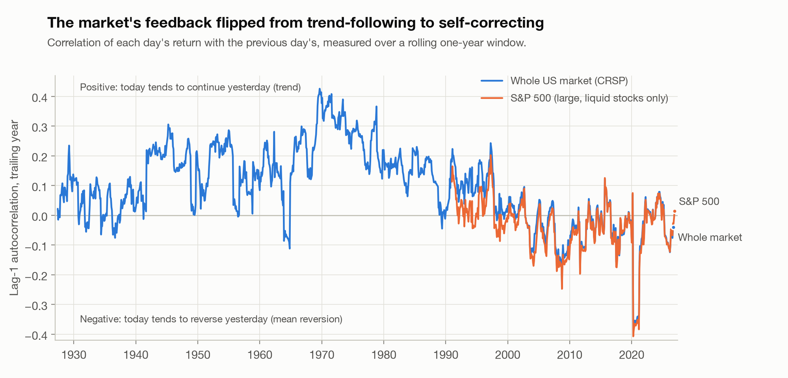

- **Lag-1 autocorrelation is higher in calm regimes, replicating LeBaron.** Over the full sample it is +0.175 calm, +0.121 normal and +0.010 turbulent (±0.02).
- **Sign flip:**

| Era | VR(21) | VR(63) | Lag-1, turbulent regime |
|---|---|---|---|
| 1926–69 | 1.26 ± 0.09 | 1.39 | +0.06 |
| 1970–99 | 1.29 ± 0.08 | 1.32 | +0.14 |
| 2000–26 | **0.75 ± 0.04** | **0.64 ± 0.07** | **−0.115** |

- **Honest caveat: part of the pre-2000 trending is a measurement artifact.** Small, rarely traded stocks carry stale prices. For 1990–99 the broad CRSP index shows lag-1 +0.078, while the S&P 500 shows +0.018 and the median individual stock ≈ 0.
- **The post-2000 mean reversion is real for liquid large caps.** For the S&P 500 over 2007–26, lag-1 is −0.12 and VR(21) is 0.69. It survives several checks:
  - with 2000–02, 2008–09, 2020 and 2022 removed (VR(21) 0.70–0.77);
  - rank-based autocorrelation (−0.04);
  - direction persistence: only 47.9% of days share yesterday's direction, below 50%.

  The **lag-1** effect, though, is concentrated in crises (2020: −0.34).
- **After big moves in turbulent regimes:**

| | Next day after a 2σ down day | Next day after a 2σ up day |
|---|---|---|
| 1970–99 | −59bp (n = 37) | +46bp |
| 2000–26 | +41bp (n = 104) | −50bp |

## Test 5: did options hedging (the Black-Scholes channel) cause the flip?

`src/test5_options.py`. Returns are standardized by trailing 63-day volatility, so crises don't dominate.

| Check | What hedging predicts | Result |
|---|---|---|
| Expiry week (5 days before the 3rd-Friday expiry) vs other weeks, with 1926–72 (no listed options) as a placebo | Feedback differs in expiry weeks only after options exist | **Feedback sign: no.** Difference is +0.03 placebo, −0.04 in 1973–99, +0.00 in 2000–26 (SE ≈ 0.03 each). **Volatility: yes.** Expiry weeks are 4% calmer since 1973 but 3% *more* volatile in the placebo era (difference −6.8% ± 2.8%, z = −2.4). |
| Dealer gamma (SqueezeMetrics GEX estimate, 2011–26) | Reversal when dealers are long gamma, continuation when short | Next-day autocorrelation is the same in both (−0.023 vs −0.027). Controlling for VIX, short gamma tilts toward continuation (t = 1.4, not significant). What actually predicts reversal is **VIX** (t = −2.9). Higher gamma goes with much calmer markets: average daily move 43bp vs 153bp. |
| SPY overnight vs trading-session split (1993–2026) | If hedging flows overshoot during the session, that move gets undone, partly overnight | What reverses is yesterday's **session** move (slope −0.065), not the overnight gap (+0.009). For 2007–26, about half the reversal comes overnight (−0.022, t = −1.9) and half in the next session (−0.016). |

**Reading:** Black-Scholes-style hedging leaves a fingerprint on the **size** of moves: expiry-cycle damping that appears only once options exist, and calm markets when dealer gamma is high. It does not explain the **sign** of the day-to-day feedback. The reversal grows with fear (VIX) and undoes trading-session moves, which fits a different story better:
- under stress, liquidity thins and forced flows (deleveraging, rebalancing, hedging) push prices too far;
- prices then snap back once liquidity providers return.

## Test 6: a two-timescale state model

Scripts: `src/test6a_timescales_market.py`, `src/test6b_timescales_stocks.py`, `src/test6c_closure.py`, `src/test6d_sector_null.py`, `src/test6e_pca_null.py`.

**The model.** Volatility is driven by K "leaky integrator" units. All of them are fed by yesterday's squared move (down moves weighted more), each decays at its own rate, and their sum sets today's variance. K = 1 is the GARCH used earlier; K = 2 adds a second timescale.

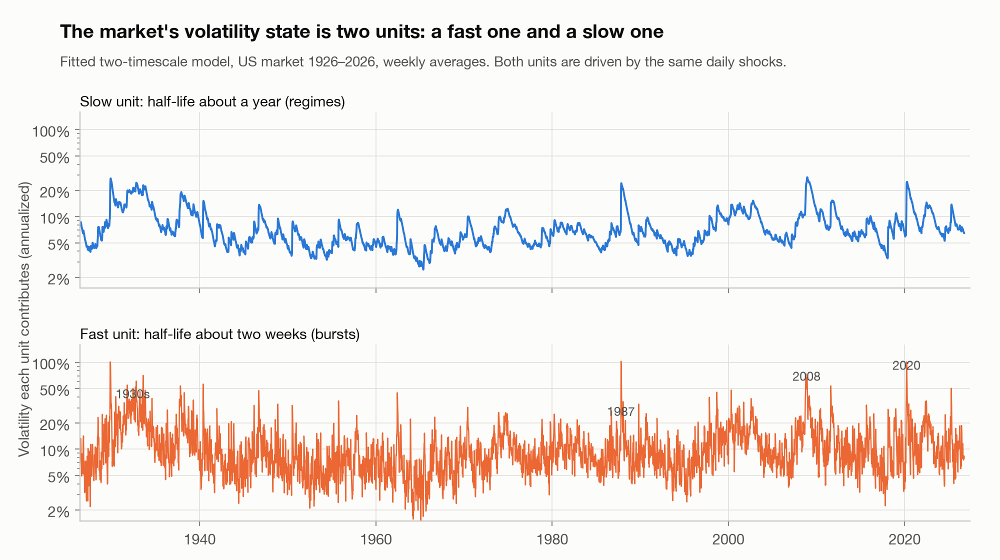

**Market, 1926–2026:**

| | Log-likelihood | Half-lives (days) | Day-to-day persistence of slowest unit |
|---|---|---|---|
| 1 unit | −31,422 | 73 | 0.9906 |
| **2 units** | **−31,323** (likelihood ratio 198) | **11 and 252** | **0.9973** |
| 3 units | −31,315 (likelihood ratio 16; BIC worse) | 9, 98 and 649 | 0.9989 |

- **Two units fit better in every era.** The likelihood-ratio statistic against one unit is 137 in 1926–69, 21 in 1970–99 and 63 in 2000–26. The fast half-life is stable at 7–13 days; the slow one ranges 120–343 days.
- **True out-of-sample test (fit on 1926–99, test on 2000–26).** The 2-unit model forecasts *tomorrow's* volatility better (Diebold-Mariano t ≈ 2.5–2.7), but not the next month's (t ≈ −0.1).
- **The leftover structure is not a timescale problem.**
  - The BDS test on the 2-unit residuals is −6.6, against a null of −0.1 ± 0.9.
  - It lives entirely in the size of moves: randomizing the signs leaves it at −7.8, while shuffling the magnitudes brings it to +0.6.
  - The pattern is overreaction. After a big surprise, the next day's surprise is smaller than the model expects (correlation −0.09, against a null of 0.00 ± 0.01).
  - A saturating input, where volatility responds to the plain size of a move with a fitted exponent of 0.9–1.2, fits much better (likelihood ratio 171 for the full century, 75 since 2000). It doesn't remove the overreaction since 2000 (−0.08; BDS −7.1).
  - Over the full century the leftover is much smaller (−0.02), so it is mainly a post-2000 feature.

**Stocks (237 S&P 500 stocks, 1990–2026):**
- Each stock's idiosyncratic volatility also splits in two, but more extremely: a median fast half-life of **1.9 days** (news) and a slow one of **635 days**.
- **Spillover regression.** Outcome: each stock's surprise today, standardized by its own 2-unit state. Predictors: yesterday's surprises. Standard errors are robust to same-day and serial correlation.

| Yesterday's surprise (per SD) | Change in today's volatility | t |
|---|---|---|
| Same stock | −1.8% (own model slightly overreacts) | −18 |
| Other stocks, same sector | +2.8% | 15.7 |
| Stocks in other sectors | +8.1% | 15.4 |
| The index itself (market factor) | +0.1% | 0.3 |

  The pattern is the same in 1990–2007 and 2008–2026. The population carries information about each stock's state that neither its own history nor the index contains.

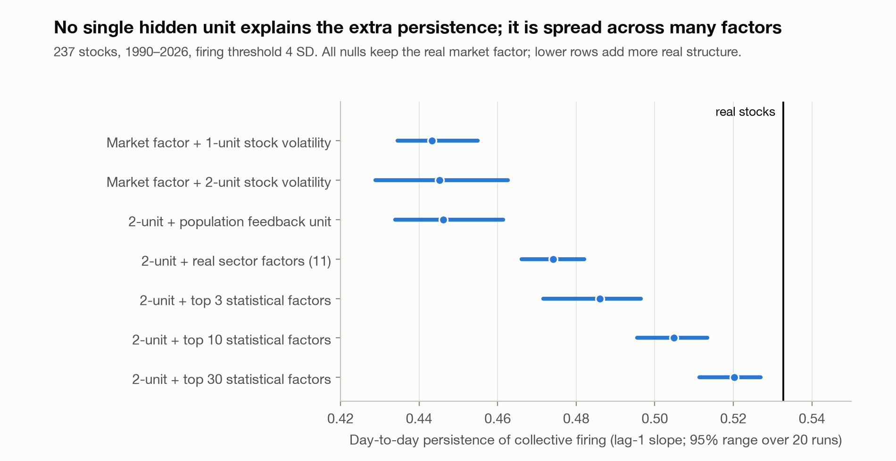

**Closing the avalanche persistence gap.** The measure is lag-1 persistence of collective firing at the 4 SD threshold; the real value is 0.533.

| Null model | Persistence | Share of gap closed |
|---|---|---|
| Market factor + 1-unit stock volatility | 0.443 | — |
| Market factor + 2-unit stock volatility | 0.445 | 0% |
| + a shared population-feedback unit (strengths from the spillover regression) | 0.446 | 0% |
| + real sector factors | 0.474 | ~33% |
| + top 3 / 10 / 30 statistical factors | 0.486 / 0.505 / 0.520 | 50% / 70% / 85% |

Thresholds 3 and 5 give the same ordering. Nulls that get more real factors inherit more of the real data, so part of that convergence is mechanical. The point is how slowly it converges: no small set of hidden units carries the extra persistence.

## Test 7: contagion vs common factors

`src/test7_contagion.py`, follow-up checks in `results/test7_followup.json`.

**Method.**
- For every pair of stocks, C_ij is the correlation of stock j's surprise yesterday with stock i's surprise today. A surprise is the market-residual return standardized by the stock's own 2-unit state.
- Common factors (with symmetric dynamics) give C_ij = C_ji. Propagation j → i gives C_ij > C_ji.
- The one-way part is A = (C − Cᵀ)/2. A stock's net leadership is the sum of its one-way links.
- Noise doesn't repeat, so the test asks whether A and leadership repeat between 1990–2008 and 2008–2026. The chance range comes from relabelling stocks.
- Two series: surprise **size** (volatility, or "firing") and surprise **direction** (signed returns).

**Validation (same pipeline, synthetic data, same size).**
- *Common factors only:* 3 latent volatility factors that spike fast and decay slowly, with uneven, nonlinear exposures. Stock leadership does not repeat (r = 0.02, p = 0.41).
- *Planted contagion:* the same data, plus 40 leader stocks whose surprises add +4% volatility per SD to the rest the next day. Detected (r = 0.45, p = 0.001); the planted leaders rank at the 90th percentile of leadership.

**Real stocks:**

| | Volatility (size) | Returns (direction) |
|---|---|---|
| Stock leadership repeats across halves | r = 0.12 (p = 0.04) | **r = 0.29 (p = 0.001)** |
| …within sectors only | r = 0.05 (p = 0.25) | **r = 0.16 (p = 0.008)** |
| …after removing 10 common factors | r = −0.02 | r = 0.13 |
| One-way share of stable lagged links | 15% | 43% |
| Sector leadership repeats across halves (11 sectors) | **r = 0.76** | r = 0.53 |
| Large → small stocks (by dollar volume) | slightly reversed: −0.0012 [−0.0025, −0.0001] | slightly reversed: −0.0007 [−0.0015, −0.0001] |

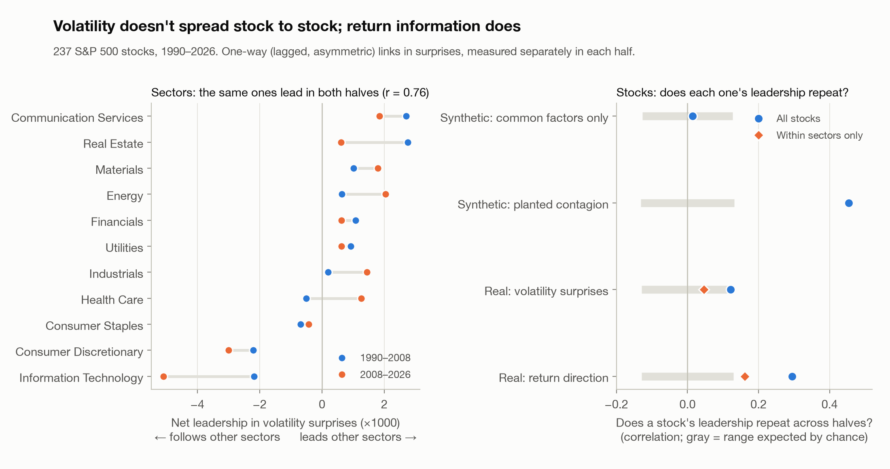

**Reading:**
- For volatility, the stable one-way structure is sector-to-sector. Communication Services, Real Estate, Materials and Energy lead; Information Technology and Consumer Discretionary follow, more strongly in 2008–26. Most of it is symmetric, factor-like co-movement. There is no detectable stock-to-stock "firing" contagion.
- For returns, one-way lead-lag exists at the stock level, consistent with slow information diffusion.
- The size pattern runs the opposite way from the classic "large leads small", but it is tiny. It is probably driven by mega-cap tech being in a follower sector, and every stock here is a large cap.

## Test 8: is it the earnings calendar?

`src/download_earnings.py`, `src/test8_earnings.py`.

**Data.** Earnings-release dates are the 8-K Item 2.02 filings on SEC EDGAR for the 237 panel stocks, 2005–2026: 20,713 releases, about 4 per stock per year.
- The reaction day is the filing day if the filing was accepted before 4 p.m. New York time, otherwise the next trading day.
- **Check that the dates are right:** surprise size on the reaction day is 3.6× normal (1.2× the day before, 1.2× the day after). Earnings windows are 3% of stock-days but hold 24% of all 4-SD firings.

**A. Reporting order vs leadership.**
- Financials report first (median 21 days after quarter end); Consumer Discretionary reports last (49 days, partly retailers with off-cycle fiscal years).

| Correlation with how early a company reports | Stocks (210 on a calendar cycle) | Sectors (11) |
|---|---|---|
| Volatility leadership | −0.05 (p = 0.45) | −0.38 (p = 0.25) |
| Return leadership | **−0.21 (p = 0.002)** | −0.56 (p = 0.07) |

(Negative means early reporters lead.)

**B. Removing earnings windows** (each stock's reaction day and the next day), 2005–2026, halves split at 2016:

| | Volatility: all days | Volatility: earnings removed | Returns: all days | Returns: earnings removed |
|---|---|---|---|---|
| Sector leadership repeats across halves | 0.44 | 0.49 | 0.38 | 0.36 |
| Stock leadership repeats across halves | 0.18 | 0.16 | 0.18 | **0.12** |

Sector volatility leadership is if anything *clearer* outside earnings season: off-season links correlate 0.77 with the full-sample ordering, against 0.56 in season.

**C. Leftover firing persistence.** The null uses each stock's real volatility path, with shocks redrawn from that stock's own non-earnings surprises, so the tails match.

| | Real | Null |
|---|---|---|
| All days | 0.538 | 0.436 [0.424, 0.446] |
| Earnings windows removed | 0.534 | 0.435 [0.423, 0.445] |

In earnings season the firing rate is 1.8% against 1.3% off-season. With earnings windows removed both are 1.17%: the extra firing in season comes entirely from the announcing companies themselves.

**D. Where earnings information goes.** Extra peer volatility after a top-20% vs a bottom-20% surprise. Peers within a day of their own announcement are excluded.

| Peer group | Same day | Next day |
|---|---|---|
| Same sector, hasn't reported yet this quarter | **+14.7% (t = 13.0)** | +1.9% (t = 1.8) |
| Same sector, already reported | +9.7% (t = 9.4) | −0.9% (t = −0.8) |
| Other sectors | +2.8% (t = 5.4) | +1.0% (t = 1.9) |

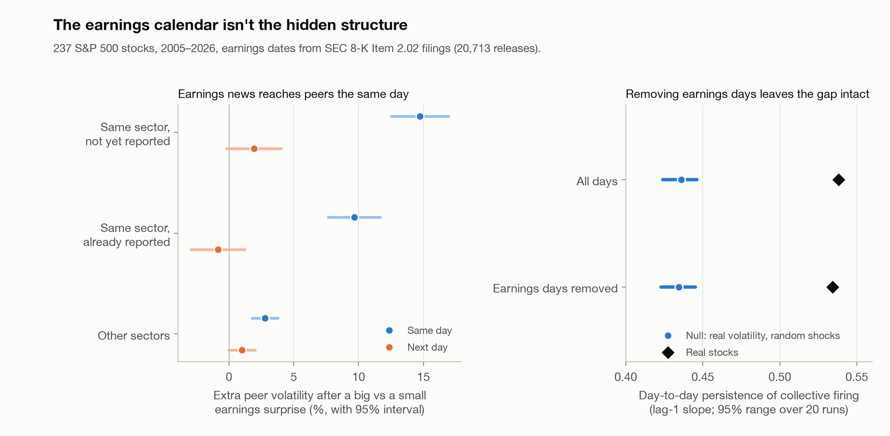

**Reading:**
- Earnings information spreads (more to peers whose own news is still pending), but it is priced **within the day**. That is why it barely shows up in one-day-lagged links and can't be the source of the lagged volatility ordering or the extra persistence.
- It does contribute to *return* lead-lag: early reporters lead, and removing earnings windows cuts stock-level return-leadership stability by about a third.

## Test 9: scheduled news, and a refractory period

Scripts: `src/parse_fomc.py`, `src/test9_scheduled_news.py`, `src/test9b_refractory.py`, `src/test9c_refractory_rolling.py`.

**Data.** Announcement dates for 2000–2026:
- FOMC: meeting dates from the Federal Reserve's calendar pages, 213 scheduled decisions, with emergency moves kept separately.
- CPI and jobs reports: release dates from the Bureau of Labor Statistics archives, 321 each.

**A. Announcement days** (variance relative to what the 2-unit model expects; 1.00 = as expected):

| | Day before | Announcement day | Day after |
|---|---|---|---|
| Fed decision (scheduled) | 0.87 (pre-Fed calm) | **1.30** | 1.55 |
| CPI release | 1.17 | 1.01 | 1.15 |
| Jobs report | 1.20 | **1.22** | 0.95 |
| Emergency Fed move | 1.18 | **2.29** | 1.26 |

**B. Scheduled news doesn't explain the overreaction.**
- Announcement-day bumps improve the fit (likelihood ratio 14–21), but the overreaction is unchanged: correlation −0.09, BDS −6.6. That holds whether or not the bump is allowed to persist.
- After a big *ordinary* day, the next day is just as overreacted to as after a big announcement day (0.80 vs 0.87 of model variance).
- The overreaction survives rank-based measures (Spearman −0.094) and removing the 2008 and 2020 crises (−0.088).
- In SPY, letting overnight gaps and trading-session moves feed volatility separately helps only a little. Overnight moves count about 0.82–0.87 as much; the correlation goes from −0.083 to −0.063.

**C. A one-day refractory period fixes it.** One added parameter damps the next day's volatility in proportion to today's surprise; the persistent state still carries the shock forward:

| | Likelihood ratio (1 parameter) | Day-to-day correlation of surprise size | BDS (dims 2 / 3 / 4) | Next-day volatility after a 3-SD surprise |
|---|---|---|---|---|
| CRSP 2000–26, base | — | −0.090 | −6.6 / −5.7 / −4.9 | 100% (by construction) |
| CRSP 2000–26, **refractory** | **70** | **−0.003** | **−0.7** / −1.8 / −2.0 | **53%** |
| SPY 2000–26, refractory | 64 | 0.000 | −0.7 / −1.5 / −1.8 | 53% |
| Shock enters a day late instead | 10 | −0.067 | −4.6 / −4.4 / −4.0 | — |
| CRSP 1926–99, refractory | 1.1 | +0.001 | +2.8 / +1.8 / +1.1 | 95% (no effect) |

The null for BDS (from Test 6) is about 0 ± 0.9. A small leftover at a two-day lag remains: the lag-2 correlation is −0.04.

**D. When it appeared** (rolling 6-year windows):

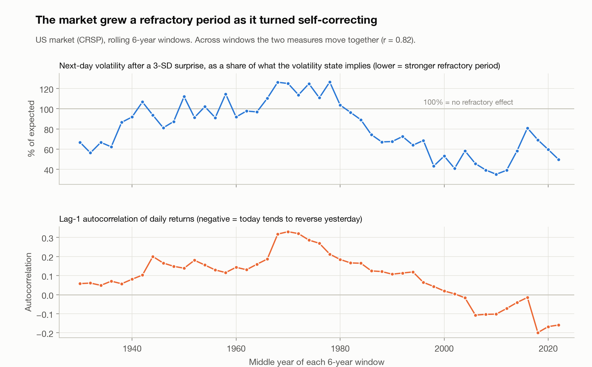

- Present in the 1930s, absent from 1940 to about 1985, emerging in the late 1980s, strongest in 1998–2013 (35–58%), weaker in 2013–19 and back since.
- Its strength tracks the lag-1 autocorrelation of returns across windows (r = 0.82).
- Caveat: the mid-century positive autocorrelation is partly the stale-price artifact from small stocks (Test 4), which could also hide a refractory effect in CRSP for those decades.

## Test 10: where the refractory period lives

Scripts: `src/test10_refractory_where.py` (model fits, ~80 min), `src/test10b_modelfree.py` (model-light checks).

**The question.** The two explanations predict different things:
- **Index-level trading** (index futures and ETF arbitrage, hedging of index options, funds that rebalance the whole index) acts on the market's common move. Stocks' own, market-removed moves should show no refractory period.
- **Ordinary liquidity provision** (market makers and short-term reversal traders working every stock) damps any price after its own big move. Stocks should show it too.

**Method.**
- The Test 9 refractory model is fitted to four levels:
  - the S&P 500 and CRSP indexes;
  - 11 GICS sector portfolios (equal-weighted, built from the stock panel);
  - the 49 Fama-French industries;
  - 237 stocks, both raw and idiosyncratic (each stock's residual after removing the S&P 500's move).
- Eras: 1990–99, 2000–12 and 2013–26.
- In the idiosyncratic fits, two damping terms compete: the stock's **own** surprise yesterday and the **market's** surprise yesterday.
- Earnings reaction days get their own variance bump, kept out of the persistent state (2005–26).
- Null: each stock's fitted base model is simulated with no refractory term, then refitted.

**A. Refractory strength by level** (next-day volatility after a 3-SD surprise, as % of what the volatility state implies; median across series; 100% = no effect):

| Level | 1990–99 | 2000–12 | 2013–26 |
|---|---|---|---|
| S&P 500 index | **69%** (LR 8) | **40%** (LR 67) | **70%** (LR 11) |
| CRSP market | 68% | 41% | 68% |
| GICS sector portfolios (11), raw | 117% | 68% | 94% |
| Fama-French industries (49), raw | 107% | 72% | 103% |
| Stocks (237), raw | 122% | 94% | 109% |
| Stocks, idiosyncratic (own surprise, market's surprise controlled) | 118% | 104% | 108% |
| Sector and industry residuals, idiosyncratic | 109–119% | 103–106% | 108–113% |

**B. Stocks have no refractory period of their own** (2000–26):
- The idiosyncratic own-surprise coefficient averages 0.011 ± 0.008 across stocks. Simulated stocks with no effect give 0.006 ± 0.004, so stocks are at the null level. The index's coefficient is 0.29.
- Earnings jumps don't hide or create it. With earnings days given their own bump (median: an earnings reaction day carries about 11× normal variance), the coefficient is −0.014 ± 0.008; without that control it is 0.020 ± 0.009.
- In the 1990s, stocks' big days were followed by *more* volatility than their state implied (about 120%): aftershocks, not refractoriness. The index already had a refractory period then (69%).

**C. Model-light check** (2000–26). Today's variance ÷ the base model's forecast, by the size of yesterday's surprise in SDs; 1.00 = as the model expects; 95% day-block bootstrap intervals:

| | 0–1 | 1–2 | 2–3 | 3+ |
|---|---|---|---|---|
| S&P 500 index, after its own surprise | 1.02 | **0.83** (0.76–0.90) | **0.72** (0.47–1.07) | 0.79 (0.44–1.45) |
| Sector portfolios, after their own surprise (pooled) | 1.02 | 0.94 | 0.97 | 1.30 |
| Stocks, idiosyncratic, after their own surprise | 1.04 | 1.11 | 1.05 | 0.88 |
| … non-earnings days only (2005+) | 0.87 | 0.93 | 0.90 | 0.94 |
| … the day after an earnings reaction | 1.50 | 1.38 | 1.03 | 0.55 |
| **Stocks, idiosyncratic, after the *market's* surprise** | 1.03 | 1.06 | **1.25** (1.15–1.37) | **1.33** (1.15–1.53) |

- The non-earnings row sits below 1 overall because removing earnings days removes the most volatile days. Its *shape* is flat: no damping after big days.
- The only stock-level damping is after big earnings jumps. This is the one-off jump the volatility state over-absorbs, not a refractory period: in the model fits, controlling for earnings doesn't change the coefficient. It probably explains the slight stock-level overreaction seen in Test 6.
- The last row holds when the stock's own surprise yesterday was small (1.25 and 1.31), so it is the market's move, not the stock's, that makes stocks louder the next day. In the model fits, the market-surprise coefficient is negative for 91–96% of stocks in every era: about +17% idiosyncratic variance the day after a 3-SD market move.

**D. The effect scales with how much of a series is the market:**

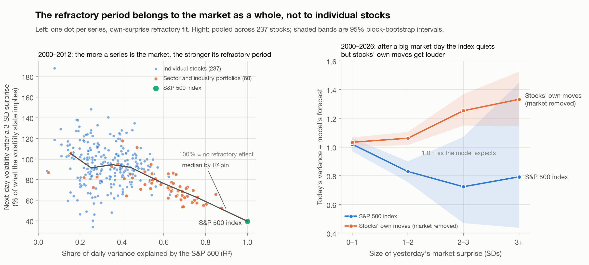

- 2000–12: the refractory coefficient rises with each series' R² against the S&P 500 (Spearman 0.39 across 297 series). By R² bin it runs 0.00 (below 0.2), about 0.04 (0.2–0.5), 0.12 (0.5–0.7) and 0.22 (0.7–0.9), up to the index's 0.41.
- This is what dilution of an index-level effect looks like. A raw stock return carries some of it only because part of the stock's move *is* the market's move.
- 2013–26: the relationship disappears (Spearman −0.09). Even sector portfolios that are 70–90% market show essentially nothing, while the index itself still shows 70%. Only 10 series sit in that top bin, though.

**Reading.**
- The refractory period is a property of the market's common move, and since 2013 of the index specifically.
- After a big market day, two things happen at once: the index is damped, and stocks' own moves are amplified. The market comes apart for a day: less synchrony right after a burst. At the daily scale this is the mirror image of Test 2, where synchrony rose over the following *months*.
- Ordinary stock-by-stock market making doesn't produce it. Something that trades the index as a single object does. Candidates:
  - index futures and ETF arbitrage;
  - dealers hedging index options (Test 5 found that dealer gamma goes with calmer index moves; Test 11 rules this out as the source);
  - funds that rebalance at the index level.
- The timing fits: the index had the effect by the 1990s, after index futures (1982) and program trading grew, while stocks didn't. That is timing only, not a test.

## Test 11: does dealer gamma create the refractory period?

Script: `src/test11_gamma.py` (about 15 seconds). S&P 500, Oct 2011 – Nov 2026 (3,792 days).

**The idea.** When options dealers are long gamma, hedging makes them trade against price moves, which should quiet the index. If that is what produces the refractory period, the dip after a big day should be deeper when dealers are long gamma.

**Method.**
- Gamma is SqueezeMetrics' GEX estimate at the close before the day being forecast, expressed as a rolling one-year percentile. GEX is negative on only 8.5% of days, mostly in 2022.
- Gamma and VIX are allowed to shift the volatility level on *all* days. The interaction terms then measure only the change in the dip after a big day.
- The model also controls for VIX and for the direction of yesterday's move. Gamma and log VIX are correlated (r = −0.49).

**A. Model fits** (likelihood ratio, 1 parameter each; 3.84 = 5% significance):

| | Full sample | Gamma 2 days back (before the surprise) | Gamma sign only (long vs short) | 2011–19 | 2020–26 |
|---|---|---|---|---|---|
| Refractory term vs none | 20.4 | 20.4 | 20.4 | 7.5 | 14.8 |
| Gamma changes the dip, alone | 3.4, **wrong direction** | 2.4, wrong direction | 0.0 | 2.8, wrong direction | 0.9 |
| Gamma changes the dip, controlling for VIX and direction | **0.2** | 0.8 | 1.2 | 0.1 | 0.1 |
| VIX changes the dip, controlling for gamma | **4.1** | 2.3 | 4.2 | **10.1** | 0.1 |
| Gamma and VIX shift the volatility level | **63** | 25 | 30 | 70 | 8 |

- **Gamma doesn't deepen the dip.** On its own, gamma points the wrong way. After a 3-SD day the next day runs at 44% of expected when gamma is low (10th percentile) and 79% when it is high (90th). Once VIX is controlled, gamma adds nothing in any version.
- **VIX may.** With gamma controlled, the next day after a 3-SD surprise runs at 83% of expected when VIX is low and 48% when it is high. The evidence is moderate: significant in the full sample and in 2011–19, absent in 2020–26.
- **Gamma does predict calmer days in general**, beyond what the volatility state expects: about 32% lower variance from the 10th to the 90th gamma percentile (t ≈ 3.4). This matches Test 5.

**B. Model-light check.** The ratio below is next-day variance after a big day (more than 1 SD) divided by next-day variance after a calm day, within each third of the sample. Dividing this way nets out gamma's and VIX's level effects. 1.00 = no refractory effect.

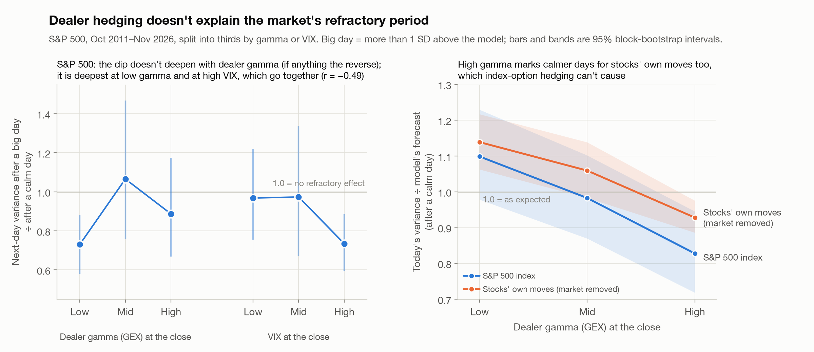

| Third of the sample | Low | Mid | High | High − low |
|---|---|---|---|---|
| By dealer gamma | 0.73 (0.58–0.88) | 1.07 | 0.89 (0.67–1.17) | +0.16 (−0.11 to +0.49) |
| By VIX | 0.97 (0.75–1.22) | 0.97 | **0.73** (0.60–0.88) | −0.23 (−0.53 to +0.02) |

- No gamma gradient in the direction hedging predicts. With a 2-SD cutoff, the VIX gap widens (top third 0.51, bottom 1.22; difference −0.71, interval −1.32 to −0.01).
- A 2×2 split of gamma by VIX is too noisy to separate the two. The parametric fit is what separates them.

**C. Gamma's calming reaches stocks' own moves**, which index-option hedging can't do. After a calm day, the market-removed variance of the 237 stocks runs at 1.14× the model's forecast in the lowest gamma third and 0.93× in the highest (0.89–0.97). The index shows a similar slope (1.10 to 0.83; right panel). So GEX looks like a marker of calm market regimes generally, not a force acting on the index.

**Reading.**
- **Dealer hedging isn't the inhibitory mechanism.** The refractory dip is not deeper when dealers are long gamma, at any timing or in either sub-period.
- Even gamma's association with calm markets (Test 5) is probably a regime marker rather than hedging: stock-specific moves, which index hedging can't touch, calm down with it.
- What remains points toward **stress**. The dip is deepest when VIX is high, just as the day-to-day reversal grows with VIX (Test 5). That fits a forced-flow reading:
  - under stress, index-level selling or buying (deleveraging, volatility-targeting and leveraged-ETF rebalancing, futures hedging) pushes the index further than information warrants;
  - the volatility state treats that push as news;
  - the next day is quieter than the state expects, because the push was a one-off.
- This is a lead, not a result: the VIX evidence is moderate and missing after 2020.

## Test 12: one model of the market brain

Scripts:
- `src/test12_brain_model.py` (fit plus 120 simulations; about 15 minutes on an idle machine);
- `src/test12c_model_v2.py` (version 2);
- `src/test12b_oos.py` and `src/test12d_rolling_oos.py` (out of sample);
- `src/figures_brain_model.py` (chart).

**The model** (fitted on 2000–2026 by maximum likelihood, then simulated):
- **Market unit (S&P 500):**
  - a two-speed volatility state driven by surprises (down days feed it, up days essentially don't);
  - the refractory term;
  - next-day and 20-day reversal in the mean.
- **11 sector units:** each sector's move beyond the market, with its own two-speed state, a persistent input from the market's squared move, and a one-day response to yesterday's market surprise. Their shocks are correlated.
- **237 stock units:** each stock's move beyond market and sector, with the same structure plus earnings-day jumps (median earnings day ≈ 12× normal variance) kept out of the persistent state.
- Stock return = market part + sector part + own part, with the real data's missing days.

**The scorecard.** 25 patterns from Tests 1–10, computed identically on real data and on 20 simulated 26-year histories per model. *Ablations* remove one piece at a time and refit without it.

**A. Each piece is needed for its own pattern** (real value; full model's simulated mean; ablated model's mean):

| Remove | Pattern that breaks | Real | Full model | Without the piece |
|---|---|---|---|---|
| Refractory term | Overreaction left by a plain volatility model | −0.087 | −0.084 | **0.000** (outside range) |
| | Quiet index day after a big day | 0.81 | 0.70 | **1.07** (outside range) |
| Reversal | Next-day reversal of the index | −0.097 | −0.047 | **−0.006** (outside range) |
| Market spillover | Stocks' own moves louder after a big market day | 1.11 | 1.08 | **0.99** (outside range) |
| Sector layer | Share of days with no stock firing | 0.35 | 0.36 | **0.22** (outside range) |
| Second (slow) volatility speed | Fat tails of index returns (excess kurtosis) | 10.6 | 21.5 | **50** (outside range); fit is worse by a likelihood ratio of 77 |

**B. What the full model gets right and wrong.**

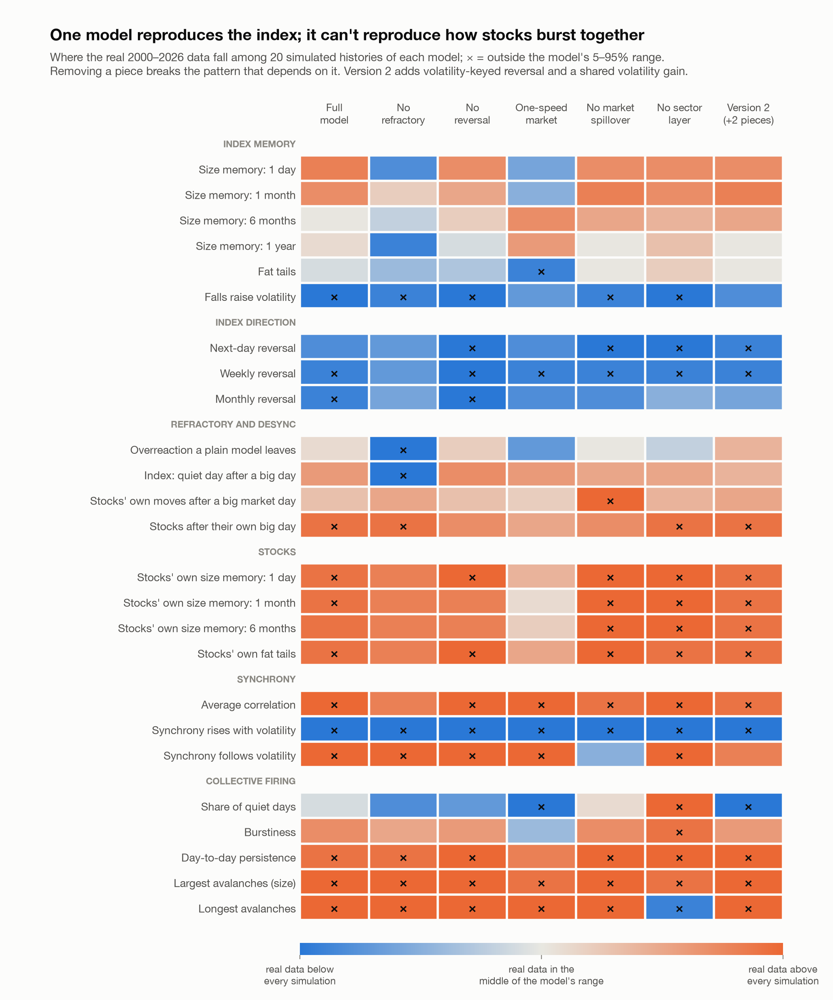

- **Right:**
  - the index's memory for the size of moves from 1 day to 1 year;
  - fat tails;
  - the refractory signature and the quiet day after big days;
  - stocks getting louder after big market days;
  - burstiness and the share of quiet days.
- **Wrong:**
  - **Collective firing:** day-to-day persistence 0.21 vs 0.54 real; largest avalanches 95 vs 208 stocks; longest 18 vs 26 days; size exponent 2.30 vs 1.94.
  - **Synchrony:** too tightly tied to market volatility (0.91 vs 0.65); average correlation slightly low.
  - **Stocks' own memory and fat tails:** too weak (lag-1 0.16 vs 0.24; kurtosis 8.9 vs 14.4).
  - **Reversal:** too weak at weekly and monthly horizons (0.94 / 0.90 vs 0.83 / 0.75).
  - **Leverage:** falls raise volatility less than in reality (−0.08 vs −0.12).
- The share of patterns inside each model's 5–95% range is not a fair overall score: noisier models cover more by being noisier. The chart shows *direction* (blue = real below the model, orange = above) for this reason.

**C. Version 2: two missing pieces, found by checking the misses directly.**
- **Reversal that strengthens under stress.**
  - Real next-day reversal is −0.11 when trailing volatility is high and −0.04 when low; version 1 has about −0.04 in both.
  - Version 2 scales the reversal with trailing 21-day volatility. Fit improves by a likelihood ratio of 11.6 (p < 0.001), and the reversal is about 2.4× stronger when volatility is double normal.
  - A first version that keyed reversal to the volatility state itself was unstable in simulation: strong reversal adds variance, which strengthens reversal. It was replaced by a separate observable gauge.
- **A shared volatility gain on stocks.**
  - Stocks' own volatilities rise and fall together about twice as much in reality as in version 1. The month-to-month spread of their common component is 0.70 vs 0.24–0.53 across simulations (5–95% range).
  - Measured from the cross-section, after removing sampling noise (about 8% of its variance), this gain has three parts:
    - a market-linked part (elasticity 0.46 to the market's volatility level);
    - a fast part with a half-life of 3.5 days;
    - a slow part with a half-life of about a year.
  - These are the same two speeds as the market's own state.
- **Result: mixed.** 16 patterns moved closer to the real data and 17 moved further.
  - **Better:** reversal at all horizons (next day −0.03 → −0.05; monthly 0.85 → 0.79; turbulent-period reversal −0.03 → −0.06); fat tails (29 → 15.5, real 10.6); the common volatility component (0.36 → 0.45); synchrony–volatility link (0.91 → 0.80); largest avalanches (88 → 145); size exponent (2.32 → 2.08).
  - **Barely moved:** collective-firing persistence (0.23 → 0.29, real 0.54).
  - **Worse:** the share of quiet days (0.37 → 0.49, real 0.35), because a smooth gain produces long lulls. Also stocks' own memory and the 6-month persistence of the common component.
  - Reading: the real shared gain is burstier, and arrives in episodes, more than a smooth multiplicative process.

**D. Out of sample.**
- **Frozen parameters** (fit 2000–2012, forecast each next day in 2013–2026; predictive log-likelihood; t from HAC errors):

  | Step | Gain | t |
  |---|---|---|
  | GJR-GARCH → two-speed state | **+19.2** | 2.7 |
  | + refractory term | −14.8 | −1.3 |
  | + constant reversal | −9.7 | −1.8 |
  | constant → volatility-keyed reversal | +8.4 | 1.9 |
  | Stocks: + earnings jumps | **+20,185** (94% of stocks improve) | 20.5 |
  | Stocks: + market spillover | +885 (80% of stocks improve) | 1.1 |
  | Sectors: + market spillover | +18 (64% improve) | 0.5 |

- **Re-estimated every year** (expanding window):
  - the refractory term is neutral (−0.8, t = −0.1), and so is the volatility-keyed reversal (−2.8, t = −0.3);
  - the refractory term loses in 2013–18, while its estimate is anchored to the strong 2000–12 era, and gains in 7 of the last 8 years as the estimate adapts (fitted strength drifts from 0.41 to 0.27).

**Reading.**
- **The model is close to complete for the index.** One set of parts reproduces its memory, tails, refractory period and the desynchronization of stocks, and each part is needed.
- **The open problem looked like collective bursts across stocks**: how a burst of stock-specific activity carries into the next day. Test 13 resolves most of it. The shared gain reproduces it on robust measures, and the raw gap came from crisis weeks.
- **Description vs forecasting.** The two-speed memory and earnings jumps are stable enough to forecast with. The inhibitory parts (refractory period, reversal) are real descriptions in every era, but their strength drifts with market structure, so they don't make better forecasts. In brain terms the memory is hard-wired; the inhibition is plastic.

## Test 13: why collective bursts persist

Scripts: `src/test13_bursts.py` (split), `src/test13b_model_v3.py` (version 3 and re-scoring), `src/figures_bursts.py` (chart).

"Collective firing" is the number of the 237 stocks moving more than 4× their typical daily size (Test 3). Persistence is how much today's count follows yesterday's.

**A. Where the gap sits.** The persistence slope splits into stocks that fired yesterday and fire again (repeat) and stocks that didn't fire yesterday but fire today (new):

| Slope | Real | Version 1 | Version 2 |
|---|---|---|---|
| Total | 0.54 | 0.29 | 0.26 |
| Same stocks firing again | 0.33 | 0.19 | 0.11 |
| New stocks joining | 0.21 | 0.10 | 0.15 |

- **Earnings aren't the cause.** Removing earnings days and the day after leaves real persistence unchanged (0.54; repeat 0.34, new 0.20; 2005–2026).
- **The raw slope is dominated by crisis weeks.** An OLS slope on counts is driven by a few weeks with hundreds of stocks firing: version 1's 5–95% range runs from 0.08 to 0.76.
- **Removing the crises shrinks the real values.** Outside Sep 2008 – Jun 2009 and Feb – Jun 2020:
  - the real slope drops to 0.35;
  - the chance that a firing stock fires again next day falls from 0.148 to 0.072.

**B. Re-scored on robust measures** (20 simulated 2000–2026 histories per version; 5–95% range; * = real outside the range):

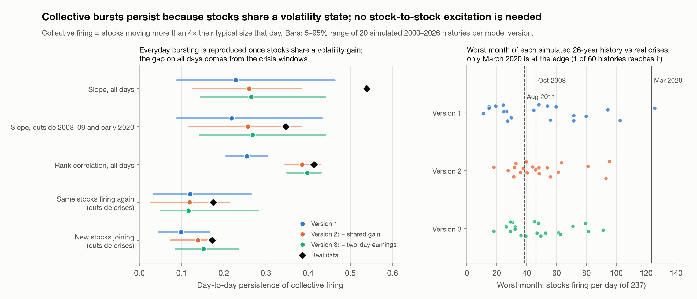

| | Real | Version 1 | Version 2 (+ shared gain) | Version 3 (+ two-day earnings) |
|---|---|---|---|---|
| Slope, all days | 0.54 | 0.23 (0.09–0.46)* | 0.26 (0.13–0.38)* | 0.27 (0.15–0.44)* |
| Slope, outside the crises | 0.35 | 0.22 (0.09–0.43) | 0.26 (0.12–0.38) | 0.27 (0.14–0.44) |
| Rank correlation, all days | 0.41 | 0.26 (0.21–0.30)* | **0.39** (0.35–0.43) | **0.40** (0.35–0.43) |
| Correlation of log counts | 0.50 | 0.31 (0.23–0.45)* | **0.45** (0.41–0.51) | **0.46** (0.38–0.53) |
| Same stocks firing again, outside crises | 0.18 | 0.12 (0.03–0.27) | 0.12 (0.03–0.21) | 0.12 (0.05–0.28) |
| New stocks joining, outside crises | 0.17 | 0.10 (0.05–0.17)* | 0.14 (0.08–0.18) | 0.15 (0.09–0.24) |
| Chance of firing again next day, outside crises | 0.072 | 0.075 | 0.068 | 0.070 |
| Stocks firing per day, outside crises | 2.3 | 1.9 (1.5–2.3)* | 2.0 (1.7–2.5) | 2.0 (1.7–2.4) |
| Worst month: stocks firing per day | 124 | 50 (15–104)* | 49 (27–93)* | 48 (26–82)* |
| Days with half of all stocks firing | 21 | 10 (1–22) | 9 (3–15)* | 9 (3–16)* |

- **Version 1 fails the robust measures; versions 2 and 3 pass.** The shared volatility gain is what produces everyday burst persistence.
- **New stocks joining a burst is reproduced with no stock-to-stock links.** Spread through the shared state is enough.

**C. Version 3: two-day earnings reactions.**
- After a big earnings move, the next day carries 3.8× pre-event variance in real data but only 1.9× in versions 1–2, which treat earnings as a one-day jump.
- A second-day bump (median 2× normal variance, vs about 12× on the day itself; also kept out of the persistent state) is strongly supported: median likelihood ratio 16.5 per stock, 89% of stocks individually significant.
- It fixes the day after earnings (3.6×, range 3.3–3.9) and the "stocks after their own big day" pattern (1.65 vs real 1.83, inside the range; version 2 gave 1.38).
- **Still missed in every version:** stocks' own day-to-day memory (lag-1 0.15 vs 0.24) and their fat tails (kurtosis 8 vs 14). Real stock-specific moves have more jump-like news than Student-t shocks capture.

**D. The crisis edge.**
- Worst real months, stocks firing per day out of 237:
  - Mar 2020: 124;
  - Oct 2008: 46;
  - Aug 2011: 39.
- 2008 and 2011 sit well inside the model's range. March 2020 is reached by 1 of 60 simulated histories (version 1: 126).
- The firing threshold is relative to each stock's typical move over the previous year. So a crash coming straight out of a calm year produces far more firing than one that follows turbulence, as 2008 did.

**Reading.**
- **Collective bursts are a shared-state phenomenon.** They persist, and spread to new stocks the next day, because stocks share a volatility state: the market's, plus a common gain with the same two speeds. Stocks don't need to excite each other.
- In brain terms: population bursts here are carried by **neuromodulation-like shared gain, not recurrent excitation between neurons**. This agrees with Test 7 (no stock-to-stock volatility contagion) and Test 6 (persistence spread over many shared factors).
- **Test 12's "open problem" was mostly measurement.** The everyday part is solved. What's left is the extreme edge (March 2020) and the jumpiness of single stocks.

## Test 14: the market unit outside the US

Scripts:
- `src/download_intl.py` (Yahoo daily closes for 15 indices);
- `src/test14_intl.py` (fits by market and era);
- `src/test14b_era_vs_stress.py` (era vs stress);
- `src/figures_intl.py` (chart).

**Markets and data.**
- **US:** S&P 500 (from 1960).
- **Europe:** FTSE 100, DAX, CAC 40, SMI, AEX.
- **Asia-Pacific:** Nikkei 225 (from 1965), Hang Seng, ASX 200.
- **Americas:** TSX, Bovespa, IPC.
- **Other emerging:** KOSPI, TAIEX, Sensex.
- Most series start between 1984 and 1997.
- Exact repeat closes (holiday stubs) are dropped. The large paired moves that remain are real crash days, not bad ticks.

**A. Two-speed volatility state:** significant in every market (likelihood ratio 20–88 over 2000–2026; 25–159 over full histories).

**B. Refractory period and feedback, by era:**

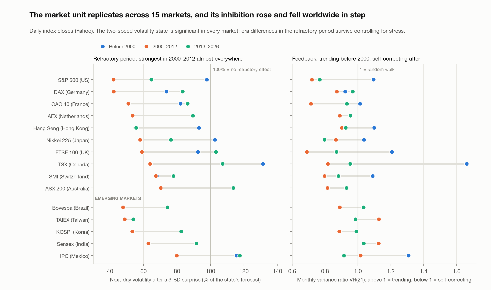

- **2000–2012: present almost everywhere.**
  - Significant in 14 of 15 markets (Mexico borderline at a likelihood ratio of 3.8).
  - The next day after a 3-SD surprise runs at 42% (US, Germany) to 80% (Mexico) of the state's forecast.
  - The plain-model overreaction signature is negative in all 15 (−0.02 to −0.13).
- **2013–2026: fades in most markets.** It stays clear in the US (65%), Hong Kong (56%), Taiwan (54%) and Brazil (74%).
- **Before 2000: mostly absent.** It appears only in Germany (74%) and Switzerland (68%). The US is at 98%, and Japan, Hong Kong, the UK and Mexico show none. Canada's significant term points the other way (aftershocks, 131%).
- **The trend-to-self-correction flip is global among developed markets.** Monthly variance ratios were above 1 (trending) before 2000 in 7 of 8 with data. They were below 1 in 2000–2012 in all 10 (0.69–0.90), and remain below 1 since (0.77–0.97). Emerging markets are mixed (Taiwan and India around 1.1), partly from stale prices in less liquid indices.
- **Reversal is stronger in turbulent periods** (2000–2026, model-free) in 13 of 15 markets. The parametric stress-keyed reversal from Test 12 is significant in 7 developed markets. It doesn't apply cleanly where next-day autocorrelation is positive.
- **The two inhibitory pieces move together.** Across the 39 market-era cells, the refractory dip tracks monthly mean reversion (r = 0.57), as it did across a century in the US (Test 9).

**C. Era or stress?**
- 2000–2012 was also the high-stress era (two global crashes), and Test 11 found the dip deepens with stress. So for each market the refractory strength was allowed to depend on a volatility gauge and on era terms.
- **The era terms survive:**
  - pooled across markets, their likelihood ratio is 252 alone and 236 with the gauge included, while the gauge adds only 30 once era is in;
  - the post-2012 weakening appears in 15 of 15 markets, significant in 10 (every developed market except Hong Kong, plus Korea);
  - the pre-2000 weakness appears in 9 of 9 markets with enough pre-2000 data, significant in 7.

**Numerical fix made in this test.**
- In thin-tailed samples (e.g. DAX 2000–2012, kurtosis 4.1), the Student-t degrees of freedom ran toward infinity. There the textbook log-likelihood loses all precision (two huge log-gamma values are subtracted), which gave nonsense fits.
- The shared likelihood functions now use the exactly equivalent log-beta form, and the degrees of freedom are capped at 1,000, which is already indistinguishable from a normal distribution.
- Earlier results are unaffected: the largest value among Test 10's 3,685 fits was 34.5, and 11.6 in Test 12.

**Reading.**
- **The market unit is a property of stock markets, not of the US.** The two-speed memory is universal. The refractory period and stress-sensitive reversal appear widely.
- **The inhibitory loop changed worldwide at the same time:** switched on around 2000, strongest through 2012, weaker since in most markets, and not explained by how stressful each era was.
- A synchronized global change points to something that changed in how stocks are traded everywhere: electronic trading, index futures and ETFs, and algorithmic market making all spread around 2000. Country-specific rules (US decimalization in 2001, Reg NMS) can't explain it alone. This is timing evidence, not a test.
- **In brain terms:** the slow memory is the same in every brain, while the inhibitory wiring developed in all of them at once, as if from a shared environment.
- *Correction from Test 15:* the post-2012 values above come from the squared-return model and are inflated. With a robust volatility model the refractory period after 2012 survives only in Hong Kong and Taiwan; the US value (65%) was mostly the model overreacting.

## Test 15: hardening the refractory period

Scripts:
- `src/test15_score_driven.py` (robust baselines, ~2 min);
- `src/download_ohlc.py` (Yahoo open/high/low/close for the 15 indices, SPY and the 237 panel stocks);
- `src/test15b_range.py` (model-free checks, ~10 min);
- `src/figures_hardening.py` (chart).

**Why.** Every refractory number so far is "variance relative to what a squared-return volatility model expected". That model is known to overreact to big days: a squared 5-SD move pushes the state up far more than the next days justify (Harvey 2013; Andersen, Bollerslev & Diebold 2007). An overreacting state makes the next day look "quieter than expected" with no refractory mechanism at all. That's the first thing a finance reader would object to, so two checks:
- refit with volatility models that don't overreact;
- measure the dip with no volatility model at all.

**A. Robust volatility models.** The same refractory term, added to two other two-unit models with the same number of parameters (7) as the squared-return model:
- **EGARCH** (Nelson 1991): the log-variance state is fed by the plain size of the move, plus a sign term.
- **Beta-t-EGARCH** (Harvey & Chakravarty 2008), the standard score-driven fix: the state is fed by the Student-t score, which is bounded, so an extreme day moves the state only a limited amount.
- The refractory term is a one-day transient on top of the state, never fed into it, exactly as before.

Both robust models fit better than the squared-return model: Beta-t beats it in 12 of 15 markets in 2000–2012 and 14 of 15 in 2013–2026, and EGARCH does better still (CRSP 2000–2026: +40 log-likelihood points).

| Next-day volatility after a 3-SD surprise (% of the state's forecast) | Squared-return (Tests 9–14) | EGARCH | Beta-t-EGARCH |
|---|---|---|---|
| CRSP market 2000–2026 | 53% (LR 70) | 68% (LR 23) | 69% (LR 22) |
| S&P 500, 2000–2012 | 42% (LR 65) | 49% (LR 43) | 50% (LR 40) |
| S&P 500, 2013–2026 | 65% (LR 15) | 94% (LR 0.3) | 95% (LR 0.2) |
| 15 markets, 2000–2012: median; significant (LR > 3.84) | 55%; 14 of 15 | 63%; 12 of 15 | 61%; 12 of 15 |
| 15 markets, 2013–2026: median; significant dips | 83%; 5 | 103%; 2 | 110%; 2 (Hong Kong 60%, Taiwan 64%) |
| Markets before 2000 (9): median | 93% | 108% | 110% |

- **2000–2012: it survives.** Under Beta-t it stays significant in 12 of 15 markets (9 at LR > 10.8). The three that drop out are Switzerland, Australia and Mexico, the weakest under the old model too. It is smaller: median 61% instead of 55%.
- **After 2012: mostly an artifact.** Only Hong Kong and Taiwan keep a dip. Four markets show significant *aftershocks* instead (UK, Switzerland, Australia, Mexico: 122–131%).
- **Simulation null.** Beta-t-EGARCH fitted to CRSP 2000–2026, simulated with no refractory term (40 histories):
  - the squared-return model "finds" a dip of 83% (5–95%: 74–100%), LR 5.6 median (95th percentile 15);
  - the Beta-t model finds nothing: 102% (89–117%), LR 0.7 (95th percentile 3.8).
  - So part of the original number was the model overreacting, but the real data (53%, LR 70 under squared returns; 69%, LR 22 under Beta-t) sit far outside both nulls.
- **Symmetric.** Separate terms after up and down days don't improve the fit (LR 0.07 for CRSP, 1.4 for the S&P 2000–2012).
- **The robust models remove only part of the overreaction signature.** The day-to-day correlation of surprise size in 2000–2012 (median) is −0.088 under squared returns and −0.060 under Beta-t. The refractory term takes it to about 0 under either.

**B. No model: the high-low range.** Shock days are days whose close-to-close move is at least 2 (or 3) times the trailing 21-day RMS move. The next day (t+1) is compared with the day after (t+2). In any model where a shock raises volatility and the effect then decays (GARCH, EGARCH, Beta-t, HAR, component models), day t+1 is at least as volatile as day t+2. So a "calmer next day" more than about half the time is the refractory signature, with no model involved.

| Share of 2-SD+ days whose next day's move is smaller than the following day's | Before 2000 | 2000–2012 | 2013–2026 |
|---|---|---|---|
| Markets pooled: 8, 14 and 15 (95% interval) | 51.8% (49.3–54.3) | **55.9%** (53.7–58.1) | 50.3% (48.3–52.2) |
| Simulated with no refractory term (each market's own Beta-t fit) | 49.9% (47.9–51.6) | 50.0% (48.5–51.8) | 49.9% (48.5–51.3) |
| Markets above 50% / above their own null's 95th percentile | 4 of 8 / 0 | **12 of 14 / 8** | 5 of 15 / 1 (Taiwan) |
| S&P 500 | 48.0% (1962–89); 55.3% (1990s) | **56.9%** (50.5–63.1) | 49.4% |
| US stocks after their own big non-earnings moves on calm market days | | 48.4% (2005–12) | 47.4% |

- The model-free statistic tracks the robust model's dip across the 35 market-era cells (r = −0.70; stronger dips go with more calmer next days).
- It also matches the timing: absent in the S&P before 1990, present in the 1990s, strongest in 2000–2012, gone after.
- Stocks show the ordinary decay pattern (below 50%): the next day after a stock's own big move is *busier* than the one after. Earnings days the same, more so (44%).
- 95% intervals: bootstrap over calendar months, since events in the same month move together.

**C. What the next day looks like inside.** The dip is mostly in how far the market gets, not how far it travels.

| SPY 2000–2012: next day's variance as % of the following day's | After a 2-SD+ day (224) | After an ordinary day |
|---|---|---|
| Intraday high-low range (activity) | 86% (66–106) | 106% |
| Session move, open to close | 56% (41–85) | 112% |
| Overnight gap | 47% (34–61) | 132% |
| Close-to-close move | **44%** (26–91) | 117% |

- In 2013–2026 all four are 104–118% after 2-SD+ days: the pattern is gone in the US.
- Across the 14 markets in 2000–2012, the next day's close-to-close move per unit of intraday range is lower than the following day's in all 14 (median 0.79). The intraday range itself shows only a small notch (median ratio 1.03; calmer next day 52.6% vs 45–47% in other eras).
- Ratio-of-sums measures like these are noisy (a few crisis days dominate), which is why the calmer-next-day share is the main model-free statistic.

**Reading.**
- **The headline survives the obvious critique, at a smaller size and in a narrower window.** The refractory period is real in 2000–2012 across most of the world's major markets, with a robust volatility model and with no model at all. It is about 60% of the state's forecast, not 50%.
- **After 2012 it is largely gone** outside Hong Kong and Taiwan. The earlier "fading after 2012" overstated what remained.
- **The refractory day is not a silent day.** The index still swings intraday, nearly as much as the elevated state implies, but its close-to-close move is about half the following day's: both the overnight gap and the session's net move shrink. In brain terms, the output is inhibited more than the activity: the network keeps firing, but excitation and inhibition cancel within the day.
- This also locates where to look for a mechanism: intraday, on the day after a big index move. Something trading the index as one object (Test 10) pushes back within the day.
- The link between the dip and monthly mean reversion across markets and eras weakens a little under the robust model (r = 0.50, from 0.57) and is weak for the model-free share (r = −0.20 against VR(21)).
- Test 14b's era-vs-stress control used the squared-return model and wasn't rerun; under the robust model the era contrast is sharper.

**Data notes.** Yahoo's index highs and lows are usable from these start dates: S&P 500 1962, FTSE 1984, DAX 1994, CAC 1990, SMI 1990, AEX 1992, Nikkei 1989, Hang Seng 1990, ASX 2001, TSX 2007, KOSPI 1996, TAIEX/Sensex 1997, Bovespa 1993, IPC 1994. Before those dates many days have high = low. How vendors record an index's daily high and low may have changed over the decades, so levels across decades are less reliable than comparisons of neighbouring days, which is all the statistic uses.

## What I'd do next (ranked)

*Done: literature check and final write-up ([WRITEUP.md](WRITEUP.md)); robustness of the refractory period to robust volatility models and a model-free test (Test 15).*
- The global post-2000 flip in index serial dependence is already documented (Baltussen, van Bekkum & Da 2019, tied to indexing), as are common idiosyncratic volatility, stress-keyed reversal (Nagel 2012) and multi-component volatility.
- The refractory period's shape, index-only location and global rise and fall were not found in that check. It remains the strongest candidate for something new.

1. **What changed worldwide around 2000 and 2012?** Line up each market's refractory strength, year by year, against the dates its exchange went fully electronic, launched index futures or ETFs, or saw algorithmic trading spread. Differences in timing across countries would give a far stronger test than the US alone.
2. **Are calm-to-crash episodes a separate regime?**
   - March 2020 is one event; the 49 industries go back to 1926 (1929–33, 1987, 2008), and the 15 indices add more crashes.
   - Test whether sudden mass firing after a calm year happens more often than the fitted model allows.
3. **Mechanism of the index-level inhibition.** Test 15 places it inside the next day: the index swings but nets out. Intraday index data (even 30-minute bars) would show when the push-back happens (open, midday, close) and whether it lines up with ETF creation/redemption, leveraged-ETF rebalancing at the close, or futures-cash arbitrage. SPY volume on big days is a cheap first look.
4. **Lower priority:**
   - stock-level jumps (the remaining stock memory and tail misses);
   - what sets the sector volatility ordering (FRED oil and rates);
   - return lead-lag as a prediction test (only if we go the prediction route);
   - the low-sync / high-vol crash-risk lead;
   - data upgrades (survivorship-free constituents, intraday data).

## Caveats

- The stock panel has survivorship bias.
- Many tests were run, so treat single p-values around 0.02 as leads.
- The nulls are one-factor with Student-t shocks.
- The CRSP data end on 30 Sep 2026.
- No transaction costs anywhere; nothing here is a trading result.
- Literature: a web check of the main attributions is in [WRITEUP.md](WRITEUP.md), with links. It was a search, not a full review, so novelty claims are provisional. Attributions elsewhere in this notebook that aren't linked there (LeBaron, Touboul & Destexhe) are still from memory.
- Test 12 uses 20 simulated histories per model; simulation ranges for single patterns are wide. The shared gain in version 2 is one specification among several possible.
- Refractory estimates before Test 15 use a squared-return volatility model, which overstates the effect (most after 2012). Tests 10–14 have not been rerun with the robust baseline; their *patterns* (index-only location, era timing) are confirmed model-free in Test 15, but their exact percentages are upper bounds.
- Index highs and lows come from Yahoo; usable start dates vary by index (Test 15 data notes).

## Reproduce

`./reproduce.sh` runs all of the steps below in order (see the [README](README.md)). The individual commands:

```bash
python3 -I src/download.py .
python3 -I src/test1_predictability.py .   # ~5 min (bootstrap)
python3 -I src/test2_synchrony.py .
python3 -I src/test3_avalanches.py . 4     # also run with 3 and 5
python3 -I src/test4_balance.py .
python3 -I src/test5_options.py .
python3 -I src/test6a_timescales_market.py .   # ~10 min (bootstrap)
python3 -I src/test6b_timescales_stocks.py .   # ~10 min
python3 -I src/test6c_closure.py .
python3 -I src/test6d_sector_null.py .
python3 -I src/test6e_pca_null.py .
python3 -I src/figures.py .
python3 -I src/test7_contagion.py .   # ~10 min (includes synthetic validation)
python3 -I src/figures_timescales.py .
python3 -I src/figures_contagion.py .
python3 -I src/download_earnings.py . <(python3 -c "import numpy as np, pandas as pd; d=np.load('results/cache/z_2unit.npz', allow_pickle=True); print(pd.DataFrame({'symbol': d['symbols']}).to_csv(index=False))")
python3 -I src/test8_earnings.py .
python3 -I src/figures_earnings.py .
python3 -I src/parse_fomc.py .          # needs the Fed calendar pages in data/macro/raw
python3 -I src/test9_scheduled_news.py .   # needs data/macro/*_release_dates.txt (BLS archives)
python3 -I src/test9b_refractory.py .
python3 -I src/test9c_refractory_rolling.py .
python3 -I src/figures_refractory.py .
python3 -I src/test10_refractory_where.py .   # ~80 min (299 series, 3 workers)
python3 -I src/test10b_modelfree.py .
python3 -I src/figures_where.py .
python3 -I src/test11_gamma.py .   # needs data/gex/DIX.csv (SqueezeMetrics)
python3 -I src/figures_gamma.py .
OMP_NUM_THREADS=1 python3 -I src/test12_brain_model.py . 20   # fit + 120 simulations (single-threaded math avoids thrashing)
OMP_NUM_THREADS=1 python3 -I src/test12c_model_v2.py . 20
OMP_NUM_THREADS=1 python3 -I src/test12b_oos.py .
OMP_NUM_THREADS=1 python3 -I src/test12d_rolling_oos.py .
python3 -I src/figures_brain_model.py .
OMP_NUM_THREADS=1 python3 -I src/test13_bursts.py . 10
OMP_NUM_THREADS=1 python3 -I src/test13b_model_v3.py . 20
python3 -I src/figures_bursts.py .
python3 -I src/download_intl.py .
OMP_NUM_THREADS=1 python3 -I src/test14_intl.py .
OMP_NUM_THREADS=1 python3 -I src/test14b_era_vs_stress.py .
python3 -I src/figures_intl.py .
OMP_NUM_THREADS=1 python3 -I src/test15_score_driven.py . 40   # ~2 min
python3 -I src/download_ohlc.py .
OMP_NUM_THREADS=1 python3 -I src/test15b_range.py .   # ~10 min (includes no-effect simulations)
python3 -I src/figures_hardening.py .
```
