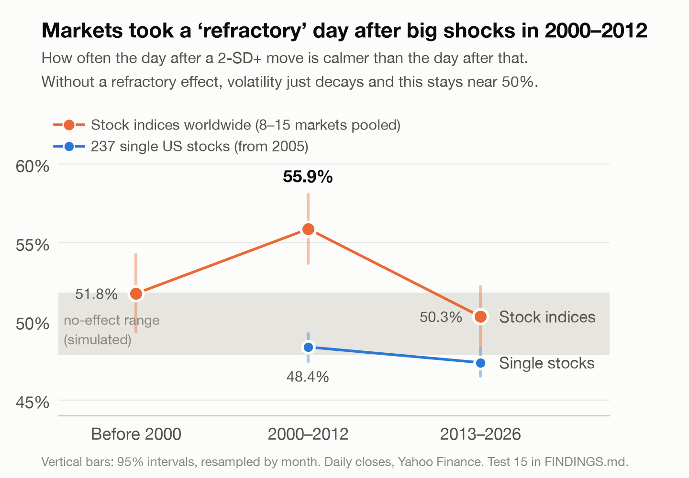

# Is the stock market like a brain?

Fifteen tests of brain-like dynamics on a century of daily market data: memory, avalanches, synchrony, excitation/inhibition balance, contagion and refractory periods. Each property is tested against a null model that has everything *except* that property.

**Read this first:** [WRITEUP.md](WRITEUP.md), the 10-minute write-up. The full lab notebook, with every number and dead end, is [FINDINGS.md](FINDINGS.md).



## The short answer

The market is brain-like in a specific, limited way.

- **It has a shared "arousal" state** (volatility) with two speeds, about 11 days and about a year. The size of moves is predictable from it (out-of-sample R² ≈ 0.25); their direction is not (R² ≈ 0).
- **It has inhibitory feedback.** Since about 2000, index returns tend to undo themselves. After a big shock the market as a whole has a **refractory day**. Individual stocks don't have one, and their own moves get louder that day.
- **It is not brain-like in the popular sense.** Avalanches don't show criticality, synchrony is not a crash warning, and stocks don't excite each other like neurons. Collective bursts are carried by a shared gain, closer to neuromodulation than to synaptic contagion.

## The headline result, and how hard it was pushed

The refractory period is the strongest candidate for something new: a literature check did not turn it up.

| | 2000–2012 | After 2012 |
|---|---|---|
| Next-day volatility after a 3-SD surprise, % of the state's forecast (robust Beta-t-EGARCH, median of 15 markets) | **≈ 61%**, significant in 12 of 15 | gone except in Hong Kong and Taiwan |
| Same, original squared-return model | 55%, significant in 14 of 15 | inflated by the model's overreaction |
| Model-free: share of big days followed by a *calmer* next day than the day after (14 markets) | **55.9%** (95% CI 53.7–58.1) | 50.3% |
| No-effect simulations / individual stocks | 50% / 48% | |

Test 15 went after the obvious objection: volatility models fed by squared returns overreact to big days, which alone makes the next day look quiet. The effect survives a model built not to overreact, and a test that uses no model, but at a smaller size than first estimated. The refractory day isn't silent. The index still swings intraday (range 86% of normal), but its close-to-close move is damped (44%).

The full robustness chart, market by market, is [Figure 15](results/figures/fig15_hardening.png) (explained in finding 5 of the [write-up](WRITEUP.md)).

## What's here

| Path | What |
|---|---|
| [WRITEUP.md](WRITEUP.md) | Final write-up: question, method, findings, literature check, limitations |
| [FINDINGS.md](FINDINGS.md) | Lab notebook: every test in order, with tables, corrections and caveats |
| [`src/`](src) | One script per test (`testN_*.py`), one per chart (`figures_*.py`), data downloaders, shared helpers (`common.py`) |
| [`results/`](results) | Each test's output (`.json`, `.csv`, `.log`) and the figures |
| [DATA.md](DATA.md) | Where every dataset comes from and why most of it isn't in the repo |
| [`reproduce.sh`](reproduce.sh) | Download the data, rerun every test, redraw every figure |
| [`docs/`](docs) | Reference: the [code map](docs/CODEMAP.md) (every script's inputs, outputs and dependencies) and the [methods](docs/METHODS.md) (models, statistics, conventions) |

### Tests and scripts

| # | Question | Scripts | Figure |
|---|---|---|---|
| 1 | Where does predictability live: direction or size? | `test1_predictability.py` | fig1 |
| 2 | Is synchrony a market state, or a warning sign? | `test2_synchrony.py` | fig2 |
| 3 | Are bursts "neuronal avalanches" at criticality? | `test3_avalanches.py` | fig3 |
| 4 | Is feedback excitatory (trend) or inhibitory (reversal)? | `test4_balance.py` | fig4 |
| 5 | Did options hedging cause the flip to reversal? | `test5_options.py` | — |
| 6 | Is there a two-timescale state? | `test6a`–`test6e` | fig5, fig6 |
| 7 | Contagion between stocks, or common factors? | `test7_contagion.py` | fig7 |
| 8 | Is the remaining structure the earnings calendar? | `test8_earnings.py` | fig8 |
| 9 | Scheduled news, and the discovery of a refractory period | `test9_scheduled_news.py`, `test9b`, `test9c` | fig9 |
| 10 | Where does the refractory period live? | `test10_refractory_where.py`, `test10b` | fig10 |
| 11 | Does dealer gamma create it? | `test11_gamma.py` | fig11 |
| 12 | One generative model of the "market brain", scored and tested out of sample | `test12_brain_model.py`, `test12b`–`test12d` | fig12 |
| 13 | Why do collective bursts persist? | `test13_bursts.py`, `test13b` | fig13 |
| 14 | Does it replicate in 15 markets worldwide? | `test14_intl.py`, `test14b` | fig14 |
| 15 | Does the refractory period survive robust models and a model-free test? | `test15_score_driven.py`, `test15b_range.py` | fig15 |

## Reproduce

Python 3.14 with the pinned packages:

```bash
python3 -m pip install -r requirements.txt
```

Then download the data (about 250 MB), run every test, and redraw every figure:

```bash
./reproduce.sh
```

- A full run takes several hours on a laptop; Test 10 alone is about 80 minutes. Stages can be run separately: `./reproduce.sh download`, `tests` or `figures`.
- The figures need the downloaded data as well as `results/`.
- Data are pulled live, so a later download covers more days and Yahoo may revise history. Expect numbers to move slightly from the ones reported here, which use data through November 2026 (Ken French data through September 2026).
- The script runs with single-threaded linear algebra, and most tests use 3 worker processes, so a run fits in 8 GB of memory.

## Limitations

- Daily data only, so the mechanism behind the refractory day (who trades, and when) is out of reach.
- The US stock panel is today's S&P 500 members, so it has survivorship bias.
- Many tests were run; single p-values around 0.02 are leads, not results.
- Tests 10–14 use the original squared-return volatility model, so their refractory percentages are upper bounds (Test 15).
- The literature check was a web search, not a full review, so the novelty claim is provisional.

**Not investment advice.** This is a study of market dynamics, not a trading strategy. No transaction costs are modelled, and the inhibitory effects drift too much over time to forecast with.

## License

Code and writing: [MIT](LICENSE). Third-party market data is not included and keeps its own terms; see [DATA.md](DATA.md).
