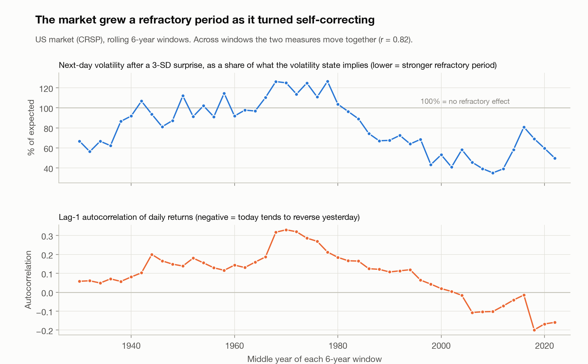
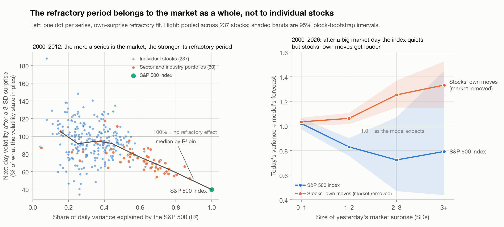
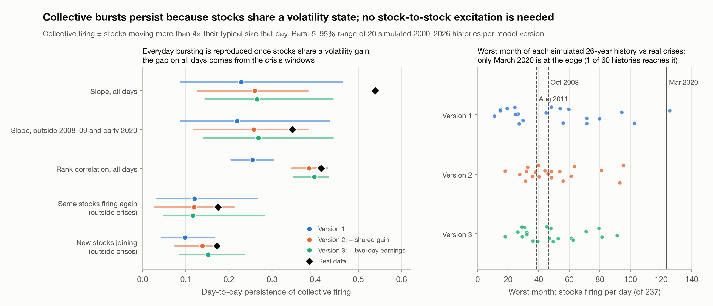
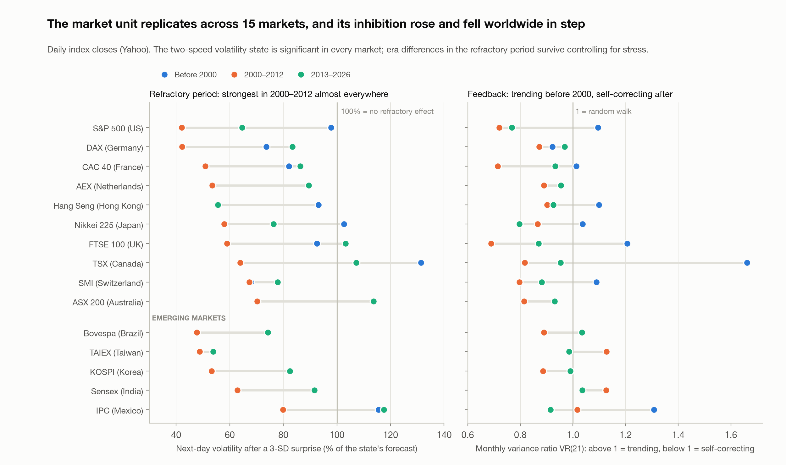
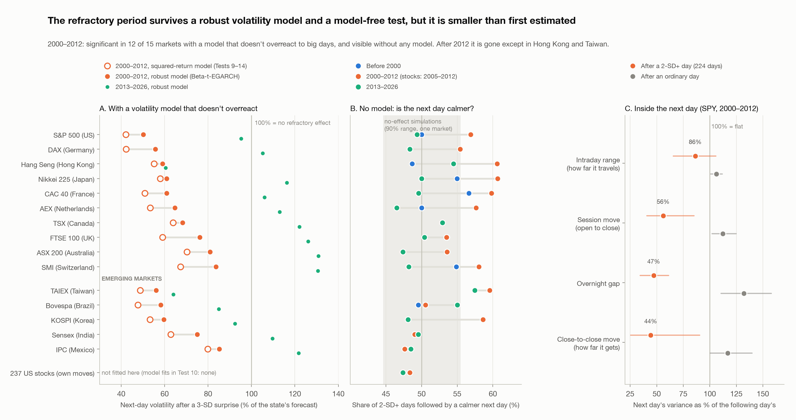

# Is the stock market like a brain? What 15 tests on real data say

*Final write-up. The full lab notebook, with every number, test and script, is [FINDINGS.md](FINDINGS.md).*

## The question

The starting idea: the stock market is a collective projection of many investors' brains, so it might behave like a brain, a recurrent network whose next state depends on its current one. Brains have recognizable dynamics:
- memory;
- bursts of collective activity ("avalanches");
- synchrony;
- a balance of excitation and inhibition;
- refractory periods after firing.

Which of these does the market actually show, and what produces them?

## What was done

- **Data.** Daily data only:
  - US market and 49 industries back to 1926 (CRSP / Ken French);
  - 237 S&P 500 stocks since 1990 (Yahoo);
  - VIX, a dealer-gamma estimate, SEC earnings dates, and Fed, CPI and jobs-report dates;
  - 15 stock indices worldwide, with daily highs and lows (Yahoo).
- **Tests.** 14 tests, each testing a brain-like property against a null model that has everything *except* that property. The pieces that held up were then assembled into one generative model of the market, simulated, scored against the real data, and checked out of sample and in other countries.
- **Stress test.** A 15th test went after the headline result's most obvious weakness, with volatility models built not to overreact and with no model at all.

## The answer in one paragraph

The market is brain-like in a specific, limited way:
- It has a **simple shared "arousal" state**: volatility, with a fast and a slow component.
- It has **inhibitory feedback**: today tends to undo yesterday, and since about 2000 a big shock is followed by a **refractory day** for the market as a whole, while individual stocks desynchronize. On that day the index still swings intraday, but its net move is damped: it travels, but doesn't get far.

It is *not* brain-like in the ways people usually imagine:
- direction is unpredictable;
- avalanches don't show criticality;
- synchrony is not a warning sign;
- stocks don't excite each other like neurons. Collective bursts are carried by a shared gain, more like neuromodulation than synaptic contagion.

The memory is the same in every market and every era. The inhibitory wiring switched on worldwide around 2000, peaked through 2012 and has since faded almost everywhere.

## Findings

**Brain properties, tested:**

| Brain property | Verdict | Tests |
|---|---|---|
| State depends on the previous state | **Yes, for the size of moves only.** One low-dimensional state with two speeds (about 11 days and about a year). Direction is unpredictable: out-of-sample R² ≈ 0 for direction, ≈ 0.25 for size. | 1, 6 |
| Criticality (neuronal avalanches) | **No.** Avalanches exist, but independent stocks driven by the real volatility paths reproduce them (branching 0.946 vs 0.940), and the "exponents" drift with the threshold. | 3 |
| Synchrony as a seizure-like warning | **No.** Synchrony was average before the 25 worst months (52nd percentile) and high after (74th–78th). | 2 |
| Synapse-like contagion between stocks | **No for volatility. A little for information:** return news flows across sectors with a one-day lag, partly via the earnings calendar. | 6, 7, 8 |
| Excitation/inhibition balance | **Flipped.** Trend-following before about 2000 (US monthly variance ratio 1.27), self-correcting since (0.75). The flip is global among developed markets, and reversal strengthens under stress. | 4, 5, 12, 14 |
| Refractory period after bursts | **Yes, strongest in 2000–2012, for the market as a whole only.** After a 3-SD surprise the next day runs at about 60% of the volatility the state implies (with a model that doesn't overreact), then the elevated state resumes. It shows up with no model at all. The dip is in the day's net move more than in its intraday activity. Individual stocks show none, and their own moves get *louder* the day after a big market move. | 9, 10, 15 |
| Collective bursts | **Carried by a shared gain**, not by stocks exciting each other. A model with no links between stocks reproduces their day-to-day persistence. | 12, 13 |

**1. The refractory period appeared in the late 1980s and was strongest around 2000–2013,** in step with the market's turn to self-correction (r = 0.82 across a century of 6-year windows).

**2. It belongs to the market as a whole.**
- The more a series is "the market", the stronger its refractory period. Individual stocks have none.
- The day after a big market move, the index quiets while stocks' own moves get 25–33% louder: a one-day desynchronization.
- It is not dealer option hedging (Test 11). It is deepest when VIX is high, but the evidence for that is moderate.

**3. One model reproduces the index and everyday collective bursting.**
- The model: a market unit (two-speed state, refractory term, stress-keyed reversal), 11 sector units, 237 stock units, a shared volatility gain, and two-day earnings reactions.
- Removing any piece breaks the pattern that depends on it.
- With the shared gain, collective-burst persistence matches the real data on robust measures (rank correlation 0.39–0.40 vs 0.41).
- What remains outside the model:
  - the most extreme crisis (March 2020, when half of all stocks fired every day for a month; only 1 of 60 simulated histories reached it);
  - the jumpiness of single stocks.

**4. It replicates worldwide, and the inhibition rose and fell in step.**
- Across 15 markets, the two-speed state is significant everywhere.
- The refractory period appears in 14 of 15 markets in 2000–2012, is mostly absent before 2000, and fades after 2012 in most.
- These era differences survive controlling for stress, so they reflect a structural change, not just crisis years.

*This chart uses the original squared-return volatility model. Its post-2012 values are inflated; see finding 5.*

**5. The refractory period survives the obvious critique, at a smaller size.**

The obvious objection: volatility models fed by squared returns are known to overreact to big days. That alone would make the next day look quieter than "expected" with no refractory mechanism. Two checks:
- **Robust volatility models.** Refit with EGARCH and with score-driven Beta-t-EGARCH (Harvey's standard fix, whose response to an extreme day is bounded). Both fit most markets better than the original model.
  - In 2000–2012 the dip stays significant in 12 of 15 markets: about 61% of the state's forecast (median), against 55% before.
  - Simulated markets with no refractory period show how much was overreaction: there, the old model reports a spurious 83% and the robust model nothing.
  - After 2012 the robust models find the dip only in Hong Kong and Taiwan. The US post-2012 effect was the old model overreacting.
- **No model at all.** In any model where a shock raises volatility and then decays, the day after a big day is at least as volatile as the day after that. In 2000–2012, across 14 markets, the next day's move was the *smaller* of the two 55.9% of the time (95% interval 53.7–58.1%). No-effect simulations give 50%, as do the years before 2000 and after 2012. Individual stocks give 48%: ordinary decay.
- **What the refractory day looks like.** In SPY, the next day's intraday range is 86% of the following day's, close to normal. Its close-to-close move is 44%. Both the overnight gap and the session's net move shrink: the index keeps swinging, but the swings cancel.

**6. Description vs forecasting.** Out of sample, the two-speed memory and earnings jumps improve forecasts. The inhibitory pieces are real in every era but drift in strength, so they don't. In brain terms: the memory is hard-wired, the inhibition is plastic.

## What is known and what may be new

A quick check of the literature (web search, not a full review):

| Finding | Status | Closest prior work |
|---|---|---|
| Volatility memory with a fast and a slow component | **Known** | Engle & Lee (1999) component GARCH; Corsi's HAR model ([2009](https://statmath.wu.ac.at/~hauser/LVs/FinEtricsQF/References/Corsi2009JFinEtrics_LMmodelRealizedVola.pdf)) |
| Avalanche-like bursts don't prove criticality; nonstationary volatility can fake it | **Consistent with known debate** | [Beggs & Plenz 2003](https://pmc.ncbi.nlm.nih.gov/articles/PMC6741045) (neuroscience); [Filimonov & Sornette](https://arxiv.org/abs/1308.6756) on spurious criticality from regime shifts |
| Index autocorrelation flipped from positive to negative after 2000, worldwide | **Known** | [Baltussen, van Bekkum & Da (2019)](https://econpapers.repec.org/RePEc:eee:jfinec:v:132:y:2019:i:1:p:26-48), who tie it to indexing (futures, ETFs) |
| Reversal is stronger under stress | **Known mechanism** (liquidity provision) | [Nagel (2012)](https://www.nber.org/papers/w17653), VIX predicts reversal returns; [Campbell, Grossman & Wang (1993)](https://www.nber.org/papers/w4193) |
| Stocks' own volatilities share a common factor | **Known** | [Herskovic, Kelly, Lustig & Van Nieuwerburgh (2016)](https://www.nber.org/papers/w20076) |
| Synchronous bursts need a shared factor, not pairwise excitation | **Known at high frequency** | [Bormetti et al. (2015)](https://arxiv.org/abs/1301.6141), Hawkes factor model of co-jumps |
| Earnings news spreads to industry peers; lead-lag is intra-industry | **Known** | Foster (1981); [Hou (2007)](https://ideas.repec.org/a/oup/rfinst/v20y2007i4p1113-1138.html) |
| Dealer gamma shapes index dynamics | **Known intraday** | [Baltussen, Da, Lammers & Martens (2021)](https://econpapers.repec.org/RePEc:eee:jfinec:v:142:y:2021:i:1:p:377-403) |
| Big shocks feed future volatility less than ordinary moves | **Related, known** | [Andersen, Bollerslev & Diebold (2007)](https://www.nber.org/papers/w11775); score-driven robust filters (Harvey); [Omori-law aftershocks](https://arxiv.org/abs/cond-mat/0111257) |
| **A one-day refractory dip in index volatility, absent in single stocks, with stocks desynchronizing, rising globally around 2000 and fading after 2012, not explained by stress; it survives score-driven volatility models and a model-free test, and lives in the day's net move rather than its intraday range** | **Not found in this check** | Nearest: the jump-persistence and serial-dependence papers above; [Lochstoer & Muir](https://afajof.org/management/viewp.php?n=250432) report a March-2000 break in index volatility measures across 35 markets, tied to index trading |
| Day-to-day persistence of collective bursts is explained by a shared gain once crisis weeks are handled | **Possibly new as stated** | Herskovic et al.; Bormetti et al. |

**What this means:**
- Much of the picture lines up with existing finance research.
- The brain framing is the organizing lens rather than a new mechanism. Its value is that it asked the right questions in the right order.
- The strongest candidate for something new is the **refractory period**: its shape, its index-only location, and its global, structural rise and fall. It survives the standard objection (Test 15), at about 60% rather than 50% of the state's forecast and mostly within 2000–2012.
- It plausibly shares a cause with the indexing-driven flip documented by Baltussen et al.: both inhibitory pieces track each other across markets and eras (r = 0.57; 0.50 with the robust model). The flip is known; the refractory dip may not be.

## Limitations

- **Daily closes only.** Mechanisms (who trades, when, why) need intraday or order-flow data.
- **Survivorship bias.** The US stock panel is today's S&P 500 members.
- **Multiple testing.** Many tests were run; single p-values around 0.02 are leads, not results.
- **Modelling choices.** Results rest on Student-t, two-unit volatility models (plus extensions). The headline refractory result was rechecked with EGARCH, Beta-t-EGARCH and a model-free test (Test 15), which shrank it; Tests 10–14 were not rerun with those baselines, so their exact percentages are upper bounds. A numerical edge case in the likelihood was found and fixed in Test 14; earlier fits were checked and unaffected.
- **Data source.** The international data are Yahoo price indices; some emerging-market indices show stale-price effects. Usable index highs and lows start between 1984 and 2007 depending on the market (S&P 500: 1962).
- **Not a full literature review.** The literature check was a web search, so novelty claims are provisional.
- **Not trading advice.** Nothing here is a trading result: no transaction costs were modelled, and the inhibitory effects drift too much to forecast with.

## If this continues

1. **Test the timing of the refractory period's rise and fall.** Line up each market's year-by-year refractory strength against when its exchange went electronic and when index futures and ETFs launched there. Cross-country differences in timing would test the "indexing" explanation far better than the US alone.
2. **Crisis regime.** Is a calm-to-crash episode like March 2020 a separate "seizure" regime or a rare tail? Century-long industry data and the 15 indices contain enough crashes to test this.
3. **Intraday data** for the mechanism of the index-level inhibition. Test 15 places it inside the day after a big move: the index swings but nets out. Intraday bars would show when the push-back happens and whether it lines up with ETF, leveraged-ETF or futures-arbitrage flows.

Scripts for every test are in `src/`. To rebuild everything, see the [README](README.md) (`./reproduce.sh`); data sources are in [DATA.md](DATA.md).
